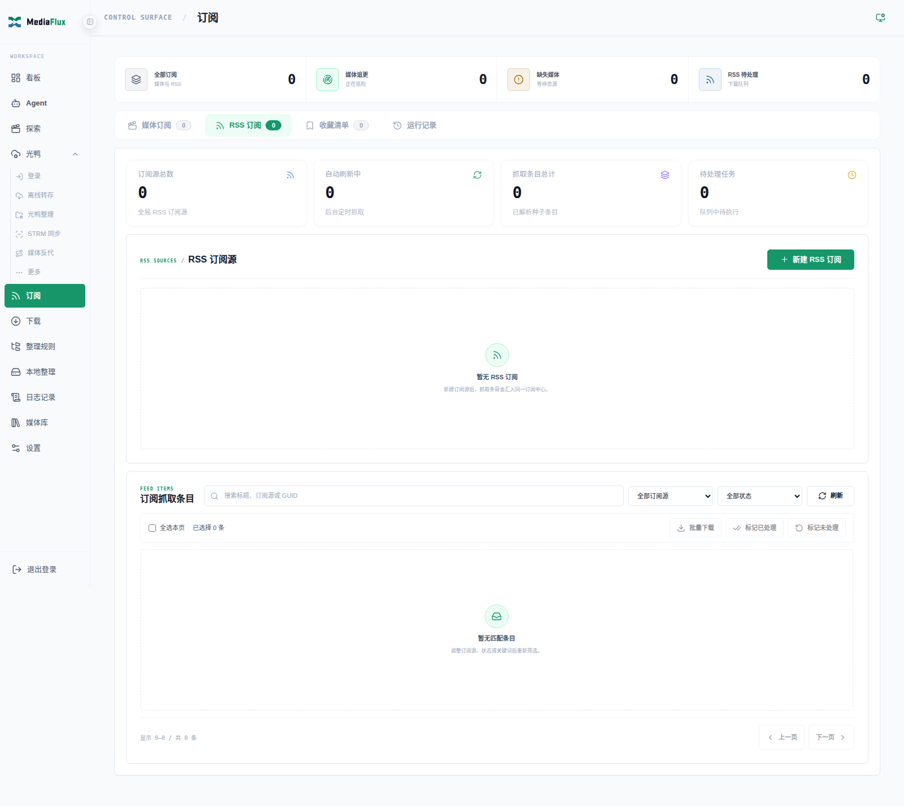
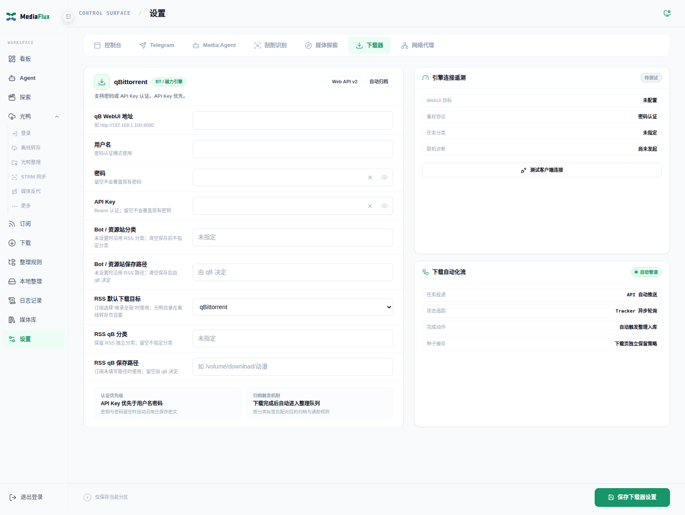

# 进阶实战：蜜柑 RSS 自动追番与过滤规则

本教程从番剧 RSS 获取发布条目，再按策略下发 qBittorrent 或光鸭。抓取、下载、整理和媒体库刷新分别核验，不把“已提交”当作已入库。

> 配置入口与行为核对日期：2026-11-17。

## 1. 工作流与前置条件

```text
蜜柑 RSS → 定时或手动抓取 → 排除关键词 / 历史条目去重
        → 仅订阅：人工选择下载
        → 自动下载：按目标提交 qB / 光鸭
        → 下载完成 → 已配置的整理链 → STRM / 媒体库刷新交接
```

先配置 **设置 → 下载器**中的 qB 或完成光鸭登录。需要下载后自动归档时，还要配置本地来源或光鸭整理来源、归档目录与联动开关；创建 RSS 本身不会自动建立这些规则。

## 2. 获取 RSS 链接

在蜜柑的番剧或字幕组页面复制 RSS 链接。例如 `https://mikanani.me/RSS/Bangumi?bangumiId=3143&subgroupid=583` 仅用于说明链接结构，实际地址与订阅范围以来源站点为准。希望只下载某字幕组时优先使用其专属 RSS。

不要公开包含个人订阅标识的链接。

## 3. 创建订阅源与设置下载默认值

进入 **订阅**（`/rss`）的 **RSS 订阅**页签，点击 **新建 RSS 订阅**：

| 字段 | 当前作用 |
| --- | --- |
| RSS URL | 多个地址换行填写，先小范围手动刷新核对条目 |
| 排除关键词 | 逗号或空格分隔，命中任一词即跳过，如 `720p, 试看`；当前表单没有“全部必须包含”的白名单输入 |
| 启用订阅 | 决定是否参与周期调度；关闭后配置保留 |
| 自动刷新周期 | `不自动刷新`仅手动触发；其他选项按分钟周期抓取 |
| 下载策略 | `仅订阅（手动确认下载）`或`自动触发离线下载`，与刷新周期分别设置 |
| 下载目标 | `继承全局`、`qBittorrent`或`光鸭云盘` |

要自动追番，需同时启用订阅、设置非零刷新周期并选择自动下载策略。暂停定时刷新不等于撤回已提交的任务；页面的手动刷新和下载是另外的操作。当前使用刷新间隔，不新增旧 `refresh_cron` 配置。

**下载默认值**位于 **设置 → 下载器**（`/settings#downloads`）：

- RSS 默认目标未配置时为 qBittorrent；选“继承全局”的订阅会跟随后续全局更改。
- RSS qB 分类独立保存。订阅的 qB 路径留空继承 RSS 全局路径，全局路径为空时由 qB 决定。
- 光鸭目标目录留空时继承 **光鸭 → 离线转存**的默认目录；表单展示名称和 ID，也可为该订阅选择独立目录。
- Bot / 资源站有独立 qB 分类与路径，不因修改 RSS 默认目标而统一改写历史配置。




## 4. 去重、季集与人工确认

历史条目去重用于减少重复提交，不保证不同发布名称一定是不同媒体。需要按媒体库已有集数过滤时，为订阅设置准确的 TMDB ID、默认季及对应的跳过已有集选项。

标准季集、绝对集数和特别篇最终都需按 TMDB 与整理规则核验，不能把每个 `SP` 或 `OVA` 都承诺为正确的 `S00E01`。季集越界或候选冲突时应在日志中纠正后继续，支持 **批量审阅光鸭待确认**，不必逐条处理 Telegram 卡片。

“启用媒体探索”等 Web 页面显示开关不暂停 RSS；RSS 自身的订阅启用、周期和下载策略才控制调度。

## 5. 失败处理与阶段通知

在订阅条目中查看失败原因、是否可重试和对应下载请求；**下载 → 待处理**用于处理下载失败，不作为整理残留目录的清理清单。认证失效先恢复账号，目录权限或容量问题先处理目标，再重试允许重试的条目，避免反复提交。

Telegram 周期告警会汇总失败分类与部分条目原因，同一问题抑制重复提醒；恢复后再次发生会重新提示。发送通知还受 Telegram 通知总开关及分类开关控制。

整理回执、STRM 结果和后台刷新入队分别表示各自阶段；Jellyfin / Emby 接受刷新后仍需自行扫描。缺集判断应结合实际媒体库，不以一条“已提交”通知下结论。

---

## 6. 相关专题教程推荐

- 🧭 [**自动化流转全景与工作流程**](00_自动化流转全景与工作流程.md)
- 🎬 [**Jellyfin 与 Emby 媒体库搭建及 STRM 302 直链播放**](01_Jellyfin与Emby媒体库及STRM播放实战.md)
- 📂 [**本地媒体安全移动与 qBittorrent 联动**](03_本地媒体安全移动与qBittorrent联动实战.md)
- ☁️ [**光鸭云盘影视归档、冲突策略与分享转存**](04_云盘大容量影视归档与冲突策略实战.md)
- 🛡️ [**整理纠偏审计、一键回退与映射锁实战**](05_纠偏审计与数据回退实战.md)
- 📺 [**Apple TV / Infuse / VidHub 302 配置与验证**](06_AppleTV与Infuse及VidHub终极直连配置.md)
- 🚀 [**性能调优与大规模媒体库优化指南**](07_性能调优与大规模媒体库优化指南.md)
