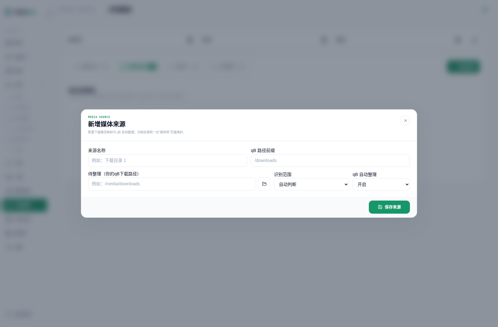

# 进阶实战：本地媒体安全移动与 qBittorrent 联动

本教程说明本地硬盘或已挂载到 MediaFlux 的 NAS 路径如何整理。当前本地归档采用移动，不提供保留原文件继续做种的硬链接工作流。

> 配置入口与行为核对日期：2026-11-17。先用少量可恢复的媒体核验路径与权限。

## 1. 下载路径与归档目录分开配置

qBittorrent、MediaFlux 和 Jellyfin / Emby 可能看到不同路径：

| 使用方 | 示例 |
| --- | --- |
| qB 下载路径 | `/downloads/anime/Frieren` |
| 宿主机路径 | `/mnt/downloads/anime/Frieren` |
| MediaFlux 看到的路径 | `/media/downloads/anime/Frieren` |

在 **本地媒体 → 媒体来源**（`/local-media#sources`）新增来源：

1. 填写来源名称与 **qB 容器路径前缀**，例如 `/downloads`。
2. **待整理（你的 qB 下载路径）**填写 MF 可访问的本地前缀，例如 `/media/downloads`；两者用于映射同一批文件。
3. 选择识别范围，并决定是否开启该来源的 **qB 自动整理**。关闭自动接管不妨碍手动检查与整理。
4. 在 **媒体库与路径映射**（`/media-libraries`）配置电影、剧集、动漫等本地归档目录，以及媒体服务器实际可见路径。归档目标不在新增来源弹窗中配置。
5. 在 **设置 → 下载器**（`/settings#downloads`）检查 qB 连接和分类、路径默认值。RSS 与 Bot / 资源站分类可不同，不要为统一执行链而合并已有分类。

远程共享应先挂载到 MF 可读写的文件系统；不能把 `smb://…` 地址直接当作本地目录。




## 2. 从预览到移动

手动入口为 **本地媒体 → 手动整理**。进入目录后，右键条目选择 **搜索刮削**或**自动匹配**，核对候选、季集与目标计划，再确认执行。识别不确定或路径冲突时先处理待确认，不能只改文件名就认为已经归档。

来自 qB 的自动整理大致按以下顺序：

```text
确认下载完成及来源 → 核对文件状态与识别计划 → 暂停 qB
    → 同盘移动，或跨盘写目标临时文件并校验
    → 提交归档结果 → 从 qB 移除任务（delete_files=False）
    → 按规则清理确定垃圾及空目录 → 媒体库刷新交接
```

- **同文件系统**：使用文件系统移动并核验身份与目标内容，不承诺“0 耗时”。
- **跨文件系统**：先写目标侧 `.mediaflux-partial-…` 临时文件，刷盘并检查体积、首尾指纹，再发布目标和清理源文件；这不是全文件逐字节哈希保证。
- **字幕**随已识别主视频进入计划；未知文件、字体和疑似 sample/proof 视频保留。只有明确命中的垃圾才进入清理，不保证来源目录必然为空。

## 3. 中断、清理与回退边界

移动异常时会尝试补偿已执行步骤；目标被占用、文件变化或回滚失败会留下待人工核验信息。断电、共享断连后的恢复应先看日志与实际文件，不能假定源文件、临时文件都已自动恢复到初态。

qB 移除失败时，结果会提示下载器清理尚未完成，来源垃圾清理受阻；不要用 qB 的“删除数据”替代复核。本地任务的清除日志只删记录，不是媒体删除或移动回退。

光鸭的“自动回收同版本落选文件”只针对云盘执行，不代表本地落选视频会被自动删除。需要清理本地条目时，使用本地手动整理提供的回收入口并核对范围。

## 4. 媒体库刷新

归档路径统一交给后台刷新链；两端路径不一致时须在 **媒体库与路径映射**中配置对应关系。剧集变化优先定位整剧以更新新集汇总日期；无整剧条目时退到单集、季或目录。电影定位自身，新作品必要时扫描所属物理根或库，不扩大到无关全库。

映射不匹配、服务器不可达或请求失败时，MF 记录提示并结束这次自动刷新，由用户在 Jellyfin / Emby 手动扫描。“已排队”不是扫描完成，也不承诺新内容即时出现在客户端。

---

## 5. 相关专题教程推荐

- 🧭 [**自动化流转全景与工作流程**](00_自动化流转全景与工作流程.md)
- 🎬 [**Jellyfin 与 Emby 媒体库搭建及 STRM 302 直链播放**](01_Jellyfin与Emby媒体库及STRM播放实战.md)
- 🌸 [**蜜柑 RSS全自动追番与标签过滤**](02_Mikan全自动追番与标签过滤实战.md)
- ☁️ [**光鸭云盘影视归档、冲突策略与分享转存**](04_云盘大容量影视归档与冲突策略实战.md)
- 🛡️ [**整理纠偏审计、一键回退与映射锁实战**](05_纠偏审计与数据回退实战.md)
- 📺 [**Apple TV / Infuse / VidHub 302 配置与验证**](06_AppleTV与Infuse及VidHub终极直连配置.md)
- 🚀 [**性能调优与大规模媒体库优化指南**](07_性能调优与大规模媒体库优化指南.md)
