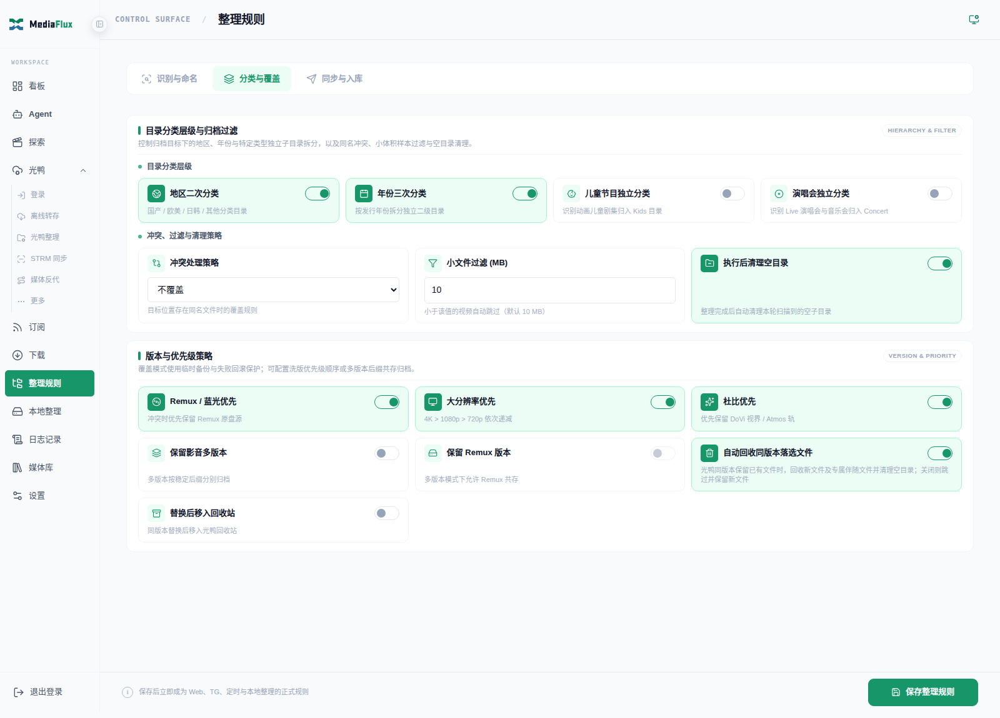

# 进阶实战：光鸭云盘影视归档、冲突策略与分享转存

本教程说明云端归档、同版本清理及分享转存。先区分待整理来源、归档目标和本地 STRM 输出目录，再执行少量预览。

> 配置入口与行为核对日期：2026-11-17。

## 1. 冲突策略与自动回收

进入 **整理规则 → 分类与覆盖**（`/organize-rules#policy`）：

| 设置 | 作用 |
| --- | --- |
| 不覆盖 | 同版本冲突时保留现有文件；新文件是否回收取决于自动回收开关及执行时核验 |
| 覆盖：大文件优先 / 小文件优先 | 按当前规则决定胜者；体积大小不能单独证明画质高低 |
| Remux、大分辨率、杜比优先 | 参与版本优先级判断，是独立选项，不是另外三个同名冲突策略 |
| 保留影音多版本 / 保留 Remux 版本 | 按稳定版本后缀共存；同版本仍受冲突策略约束，不是任意重复文件都保留一份 |
| 自动回收同版本落选文件 | 默认开启，作用于光鸭正式执行；关闭后跳过并保留落选来源 |

版本分类主要区分 DoVi / 标准版、Atmos / 非 Atmos，以及可选的 Remux / Encode。实际命名和处置以预览为准。

自动回收只在确认已有可保留版本后执行，使用整理日志已有删除事务，记录保留方及回收结果；同时处理可明确归属的专属伴随文件。识别不确定、保留文件无法复核或任务失败时不强行清理。

属于 MF 下载请求的暂存目录，在视频处理成功后可沿已核验的空父链收尾到 `MF-…` 根目录；配置的长期来源根、非空目录、活动下载与其他待确认内容会保留。不能仅看到名称相似就回收整个目录树。

关闭自动回收后，可在 **日志记录**中选择对应光鸭日志，使用 **批量移入光鸭回收站**。手动回收与清除日志不是同一操作，历史保留文件也不应仅靠清日志来处理。

## 2. 预览、执行与待确认

1. 进入 **光鸭 → 光鸭整理**（`/organize`），配置待整理扫描来源与唯一归档目标，不能相互重叠。
2. 点击 **预览整理计划**，核对作品、季集、归档路径、替换或回收说明。预览不移动、改名或删除云盘文件。
3. 确认后 **立即启动整理**，按页面要求输入 `ORGANIZE`。正式任务处理所选来源，预览条数上限不限制正式任务范围。
4. 查看执行结果与日志。云端移动、改名和回收分步骤执行，不是一项可整体无条件回滚的原子操作；停止也不会撤销已完成步骤。

遇到待确认时，在 **日志记录 → 批量审阅光鸭待确认**筛选本次任务，跨页选择媒体组，逐组保存候选或请求已启用的 Agent 只读复核，再预览并确认后台整理。既无已保存人工选择、也无有效建议，或仍待核验的组不会被自动当作首个候选提交。详见[纠偏与批量审阅](05_纠偏审计与数据回退实战.md)。

归档后，STRM 来源应指向归档目录。选择光鸭 `/整理` 时，本地通常为 `STRM_ROOT/光鸭云盘/整理/…`；仅选择 `/整理/电影` 时通常为 `STRM_ROOT/光鸭云盘/电影/…`。来源目录已分配后会持久化，新增或移除其他来源不把它自动改成平铺布局；同名或路径冲突时以实际分配结果为准。

## 3. 分享转存与后续归档

1. 进入 **光鸭 → 更多 → 分享转存**（`/guangya/more`）。
2. 解析合法获取的光鸭分享链接与提取码，查看文件树和体积，勾选所需文件或子目录。
3. 选择云盘目标并提交；云端接受后继续核对实际完成结果，不承诺任意容量“秒传”。
4. 确认转存后的目录属于配置的整理来源，再手动或定时整理。分享转存本身不等于完成 TMDB 识别、STRM 或媒体库扫描。

---

## 4. 相关专题教程推荐

- 🧭 [**自动化流转全景与工作流程**](00_自动化流转全景与工作流程.md)
- 🎬 [**Jellyfin 与 Emby 媒体库搭建及 STRM 302 直链播放**](01_Jellyfin与Emby媒体库及STRM播放实战.md)
- 🌸 [**蜜柑 RSS全自动追番与标签过滤**](02_Mikan全自动追番与标签过滤实战.md)
- 📂 [**本地媒体安全移动与 qBittorrent 联动**](03_本地媒体安全移动与qBittorrent联动实战.md)
- 🛡️ [**整理纠偏审计、一键回退与映射锁实战**](05_纠偏审计与数据回退实战.md)
- 📺 [**Apple TV / Infuse / VidHub 302 配置与验证**](06_AppleTV与Infuse及VidHub终极直连配置.md)
- 🚀 [**性能调优与大规模媒体库优化指南**](07_性能调优与大规模媒体库优化指南.md)
