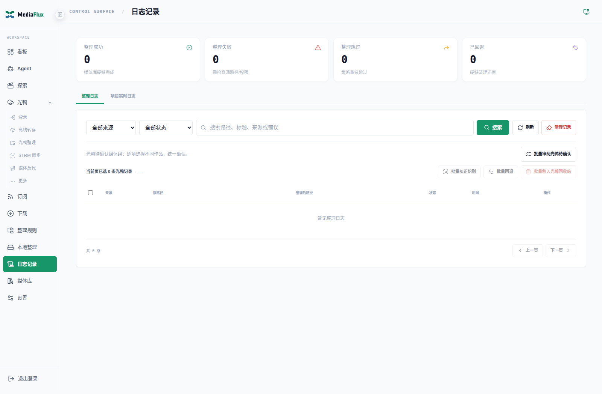
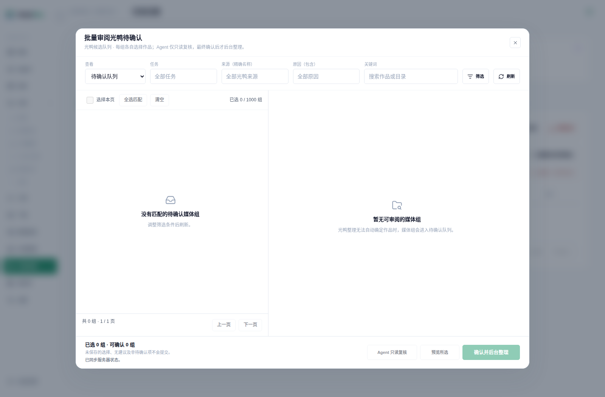

# 进阶实战：整理纠偏、批量审阅与回退

识别有歧义时先保留待确认；归档有误时按实际日志纠正。回退依赖仍有效的操作记录和文件状态，不能承诺每次操作都可完整撤销。

> 配置入口与行为核对日期：2026-11-17。以下日志回收与回退按钮针对光鸭记录；本地任务在“本地媒体”查看和处理。

## 1. 在日志中纠正一条或一批媒体

进入 **日志记录**（`/logs`），筛选来源、状态、路径或任务：

- 打开 **详情**，搜索正确 TMDB 候选，按需修正季号、集号，查看命名与路径预览，再 **执行重新整理**。只改文件名不代表已完成识别归档。
- 同一批剧集可在当前页选中记录，使用 **批量纠正识别**；核对共同作品、季集及逐项计划后再确认。不能把电影或不同作品混入同一剧集批次。
- **送回源目录**依据原来源记录移回文件；**回退最近操作**依据最近有效操作记录补偿。文件缺失、目标被占用或状态变化时可能拒绝或仅部分完成，先看结果，不盲目重放。
- **移入光鸭回收站**处理媒体与可归属伴随文件，并按范围核验空目录；清除日志只移除记录，不等于回收媒体，也不替代云盘回收站恢复。

## 2. 批量审阅待确认，不必逐条点通知

点击 **批量审阅光鸭待确认**：

1. 按任务、来源、原因或关键词筛选。可选择本页或全选匹配，跨页累计最多 1000 个媒体组；与日志表格当前页多选是两种范围。
2. 连续查看媒体组，核对作品候选、季集及来源，保存人工选择。需要模型建议时点击 **Agent 只读复核**；此操作不移动云盘文件，也不等同于最终确认。
3. **预览所选**，检查目标目录与待执行动作。仅有未保存选择、既无人工选择也无有效建议，或仍待核验的项目不提交。
4. **确认并后台整理**。确认期间候选或规则变化会要求重新核对预览，不能把旧建议直接套到新状态。

这条人工链与自动整理共用后处理：整理、STRM 和后台媒体库刷新各有结果。Telegram 摘要可刷新状态；“已交接后台刷新”表示 MF 完成交接，不表示 Jellyfin / Emby 扫描已经结束。

## 3. 人工锁定与强制匹配各有范围

人工选择形成的识别锁用于复用已确认身份，带有原名及上下文约束，不是对任意相似关键词永久放行。季集和文件操作仍须核验。

对长期异常命名，进入 **整理规则 → 识别与命名 → TMDB 强制匹配规则**（`/organize-rules#naming`）：

1. 设置明确的匹配正则及文件名 / 父路径范围，避免匹配整类无关内容。
2. 填写 TMDB ID、媒体类型及可选季覆盖。
3. 用真实命名样例验证后启用。命中后采用已校验条目，跳过普通搜索和 AI；规则有误时应停用或修改，而不是再叠一条宽泛规则。

旧 `/tools` 页面已转到设置，当前维护入口是“整理规则”，不再按旧教程寻找工具页映射锁弹窗。

## 4. 预处理与回退前检查

**整理规则 → 识别与命名 → 管理预处理**支持删除或替换命中内容、覆盖季号、季集偏移，并可限定来源与媒体类型。它只改变识别和归档计划，不直接改云盘文件。显式 TMDB ID、人工锁和强制匹配仍优先。

例如仅处理发布组前缀，可用 `^\[[^\]]+\]\s*` 匹配开头方括号段，先预览再启用；不要把整段标题都吞掉。偏移只调整已经解析出的季集，不凭空生成缺失集号。

回退前先确认原来源、现文件和目标路径，检查最近操作及删除记录。回收站删除、来源清理、STRM 镜像变化和媒体服务器扫描不是同一个可逆事务；外部手工修改或文件已回收后，应按对应状态恢复，不把“回退最近操作”理解成任意历史一键撤销。

---

## 5. 相关专题教程推荐

- 🧭 [**自动化流转全景与工作流程**](00_自动化流转全景与工作流程.md)
- 🎬 [**Jellyfin 与 Emby 媒体库搭建及 STRM 302 直链播放**](01_Jellyfin与Emby媒体库及STRM播放实战.md)
- 🌸 [**蜜柑 RSS全自动追番与标签过滤**](02_Mikan全自动追番与标签过滤实战.md)
- 📂 [**本地媒体安全移动与 qBittorrent 联动**](03_本地媒体安全移动与qBittorrent联动实战.md)
- ☁️ [**光鸭云盘影视归档、冲突策略与分享转存**](04_云盘大容量影视归档与冲突策略实战.md)
- 📺 [**Apple TV / Infuse / VidHub 302 配置与验证**](06_AppleTV与Infuse及VidHub终极直连配置.md)
- 🚀 [**性能调优与大规模媒体库优化指南**](07_性能调优与大规模媒体库优化指南.md)
