# MediaFlux 使用指南

> 更新日期：2026-11-17
>
> 截图取自当前版本的独立演示环境，账号、目录路径和业务数据均为示例；实际内容以你的配置为准。

## 目录

- [1. 首次使用顺序](#1-首次使用顺序)
- [2. 看板与搜索](#2-看板与搜索)
- [3. 统一整理规则](#3-统一整理规则)
- [4. 光鸭云盘](#4-光鸭云盘)
  - [4.1 登录与目录浏览](#41-登录与目录浏览)
  - [4.2 离线任务与分享转存](#42-离线任务与分享转存)
  - [4.3 自动整理与人工刮削](#43-自动整理与人工刮削)
- [5. 本地媒体整理](#5-本地媒体整理)
- [6. STRM 同步与播放](#6-strm-同步与播放)
  - [6.1 来源目录与落盘层级](#61-来源目录与落盘层级)
  - [6.2 同步与媒体库刷新](#62-同步与媒体库刷新)
  - [6.3 媒体反代与手动播放映射](#63-媒体反代与手动播放映射)
  - [6.4 关闭伴随同步后清除积压](#64-关闭伴随同步后清除积压)
- [7. RSS 与下载](#7-rss-与下载)
- [8. Telegram Bot](#8-telegram-bot)
- [9. 媒体探索与资源搜索](#9-媒体探索与资源搜索)
- [10. 日志与纠偏](#10-日志与纠偏)
- [11. Media Agent](#11-media-agent)
- [12. 移动端](#12-移动端)

## 1. 首次使用顺序

1. 未初始化的实例先打开 `/setup` 创建管理员账号；已配置管理员凭据的实例从 `/login` 进入。
2. 在看板顶部点击“配置媒体服务器”，分别配置并启用 Jellyfin/Emby。
3. 在“设置 → 刮削识别”配置 TMDB API Key。
4. 按使用场景配置 qBittorrent、Telegram、光鸭和网络代理。
5. 在“整理规则”确认分类、扩展名、冲突和通知策略；整理后的命名采用固定规则，输入文件名的发布格式识别可另行教学。
6. 再配置光鸭整理、本地媒体来源和 STRM。

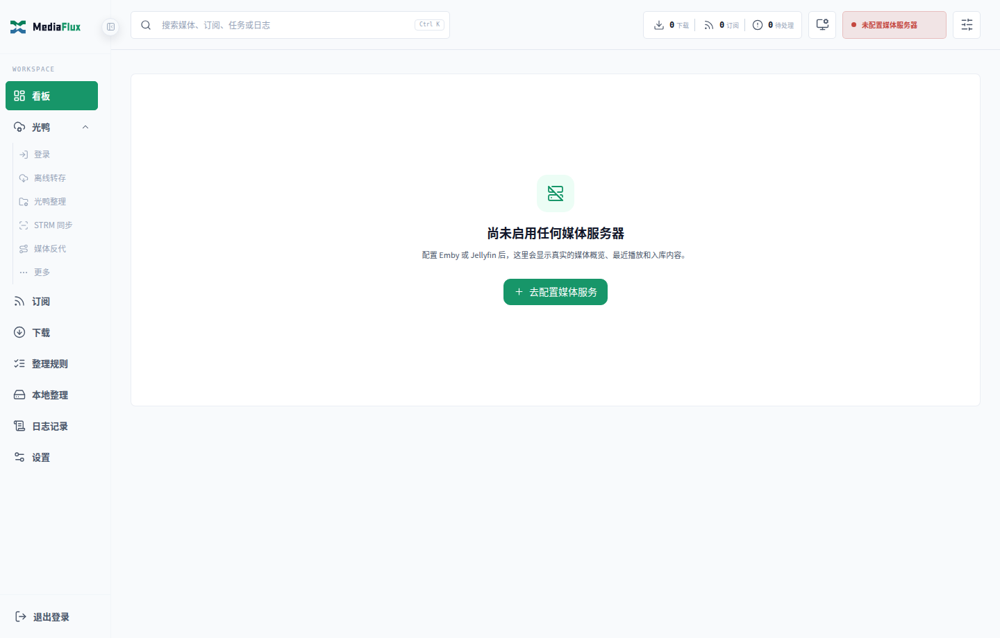

## 2. 看板与搜索

看板显示媒体服务器概览、下载/订阅/待处理状态、最近播放和最近入库。未配置媒体服务器时会显示明确的空状态。

点击顶部服务器选择器旁的“配置媒体服务器”，填写服务地址、API Key / Token 和按需使用的观看用户 ID。Jellyfin 与 Emby 分别保存，可独立启停；启用后从选择器切换查看。设置页的“控制台”用于管理员登录凭据和登录页展示。

顶部全局搜索可检索媒体、订阅、任务和日志。搜索页打开非本地媒体档案后，关闭会返回原搜索结果。

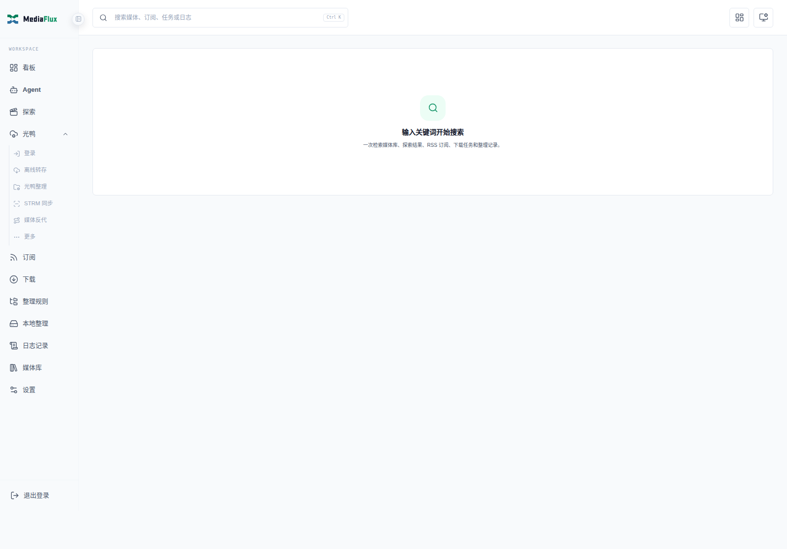

## 3. 统一整理规则

进入 `/organize-rules` 配置：

- 视频与伴随文件扩展名。
- 固定输出命名：电影使用独立 TMDB 媒体目录，剧集使用 `Season N`（季号不补零）与 `SxxExx`。
- 媒体规格自动尽力补全：本地直接 ffprobe，光鸭使用 signedURL/直链与成功缓存。
- TMDB 强制匹配规则、映射锁和 AI 回退。
- 电影/剧集/动漫分类目录。
- 冲突策略、多版本、回收站、空目录清理。
- Telegram 通知、STRM 联动和媒体库刷新。

规则同时供光鸭、本地、Web、Telegram 与定时任务使用。整理后的命名、媒体信息补全和媒体探测采用固定策略，不提供自定义输出命名模板；探测失败回退到文件名规格，不因规格探测失败阻断归档。

“发布格式”用于识别输入文件名中的标题、原始季集等信息，与整理后的输出命名分开。可以向 Agent 提供真实文件名和正确标注，先查看只读解析与教学预览；明确要求记住并确认保存后，才影响以后匹配的文件。发布格式不会自行锁定 TMDB 身份，也不会把原始集号自动解释成另一季的集号。长期异常资源的身份规则和 TMDB 映射锁仍在相应 Web 页面管理。

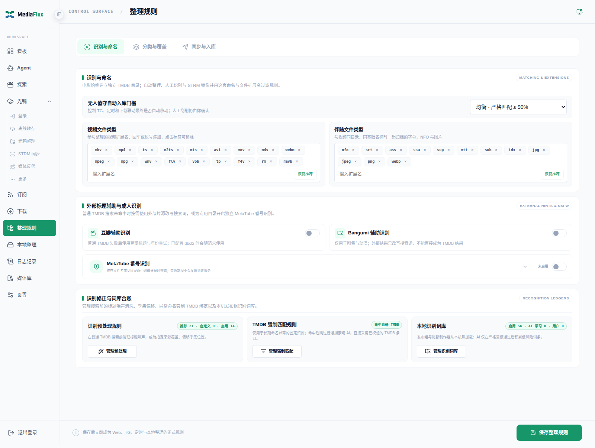
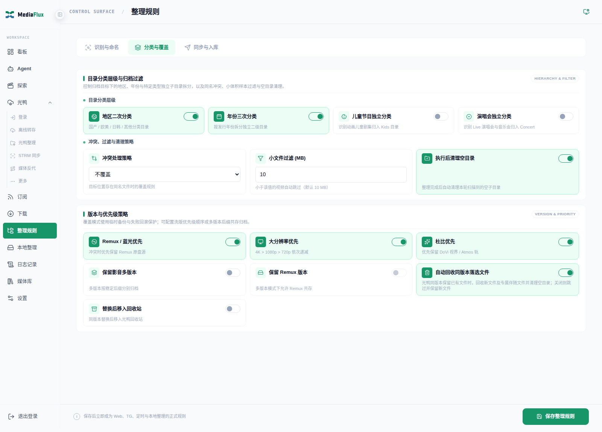

## 4. 光鸭云盘

### 4.1 登录与目录浏览

在“光鸭 → 登录”完成短信登录。目录浏览支持列表/网格、名称/时间/类型/大小排序、删除和媒体刮削操作。

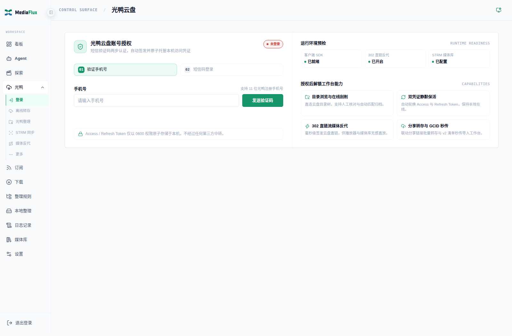

### 4.2 离线任务与分享转存

- “离线转存”提交磁力、ED2K、HTTP(S) 或种子。
- 允许扩展名为空时使用内置媒体默认值；解析器排除的文件不会触发伪完成通知。
- “分享转存”先解析文件树，再选择需要转存的文件和目标目录。

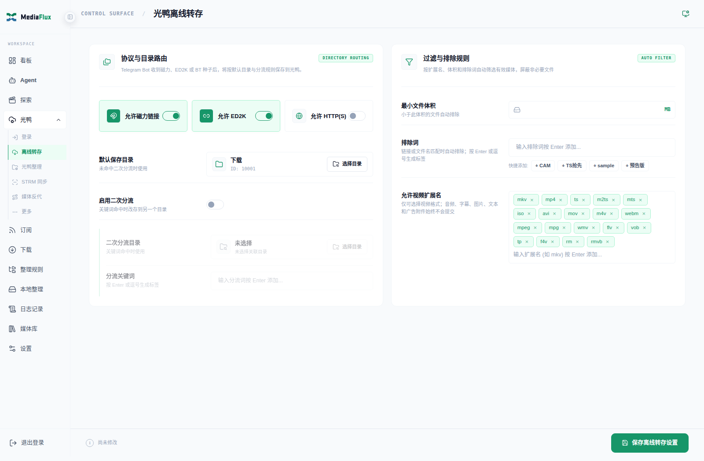
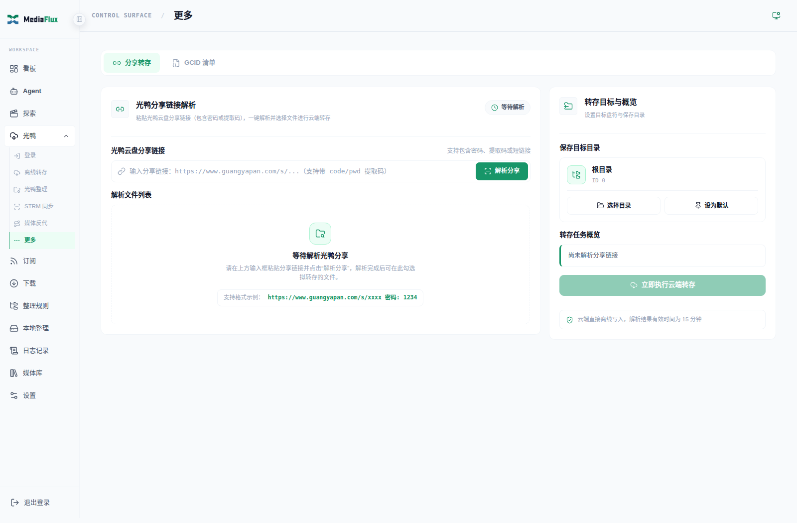

### 4.3 自动整理与人工刮削

“光鸭 → 网盘整理”配置多个来源目录和归档目标。执行前建议先生成预览。

目录浏览中的媒体目录或媒体文件可选择：

- 搜索并刮削：手工修改搜索词、类型、季号和 TMDB 候选。
- 自动匹配并刮削：复用统一识别规则，可靠命中后归档。

低置信度、集号超出 TMDB 范围、目录内存在多个真实媒体或冲突无法安全解决时进入人工确认，不强行写入。

“设置 → 刮削识别”中的 AI 回退和 Agent 主动复核分别控制不同阶段。AI 回退在确定性识别失败后提供候选，仍需通过 TMDB 校验；主动复核核对待确认项，单组通过确定性校验时可自动确认，同一次整理产生多组时只给建议，由你在批次摘要或网页中确认。未开启相关功能时，仍可人工搜索、选择和预览。

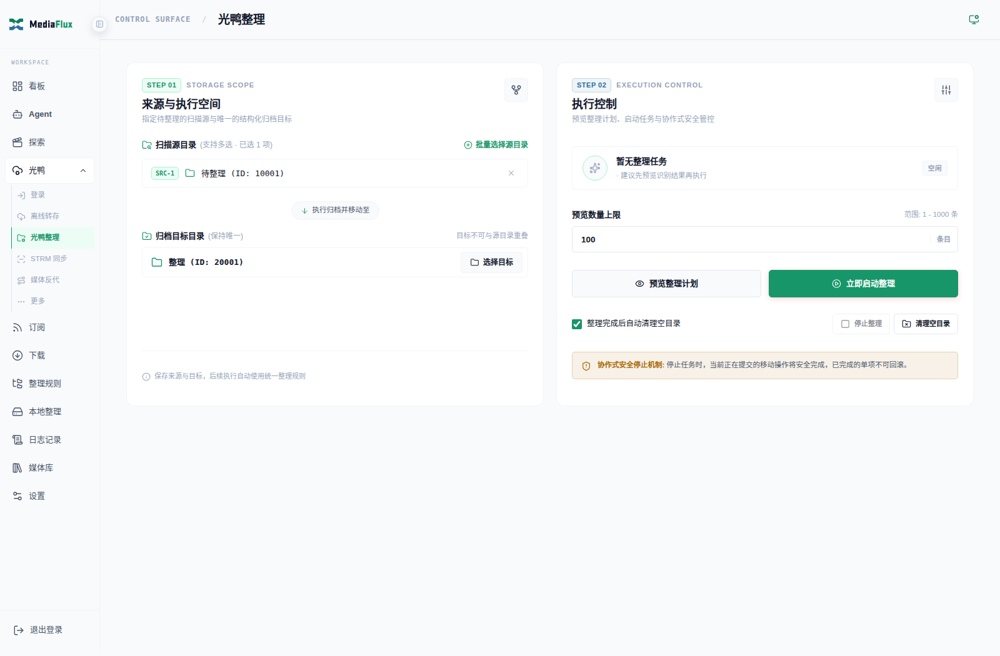
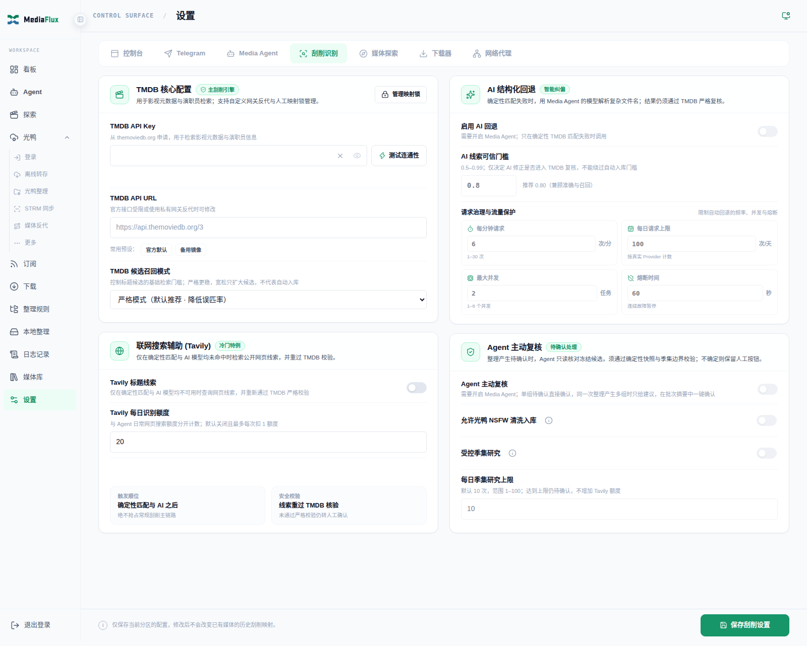

## 5. 本地媒体整理

进入 `/local-media`：

1. 新增来源，填写来源名称、qB 容器路径前缀和 MediaFlux 可见的待整理目录。
2. 选择识别范围，并按需开启 qB 下载完成后的自动整理。
3. 在 `/media-libraries` 统一维护电影、剧集、动漫等归档目录及 Jellyfin/Emby 可见路径。
4. 手动整理时先“检查目录”，再搜索/自动匹配并查看无副作用计划。
5. 确认后执行安全移动；跨文件系统会先复制到目标临时文件、校验，再删除源文件。
6. 定时整理与手动整理共用统一规则和日志。

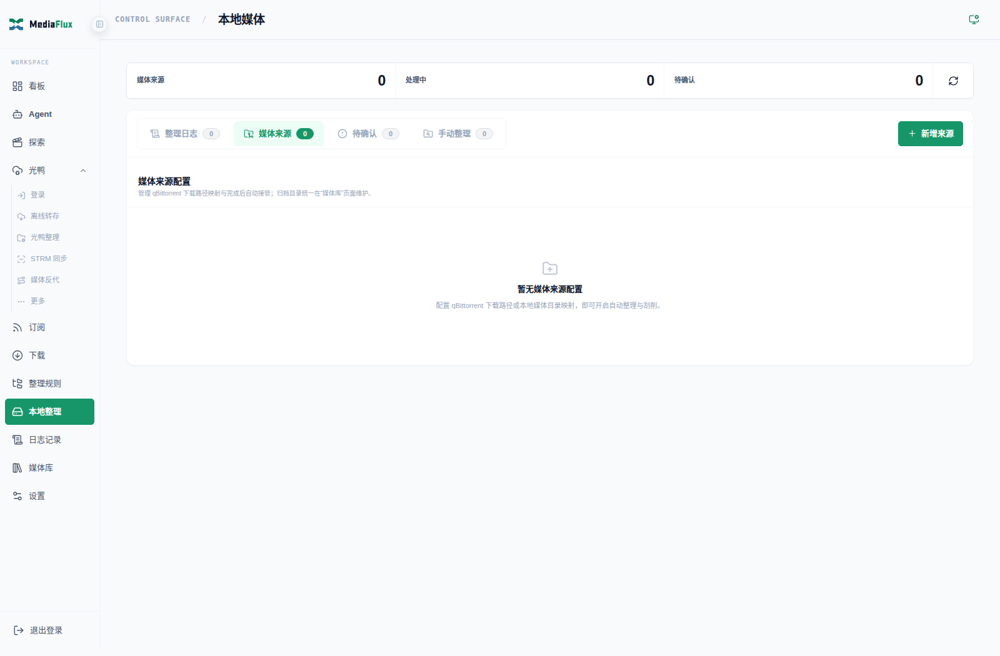
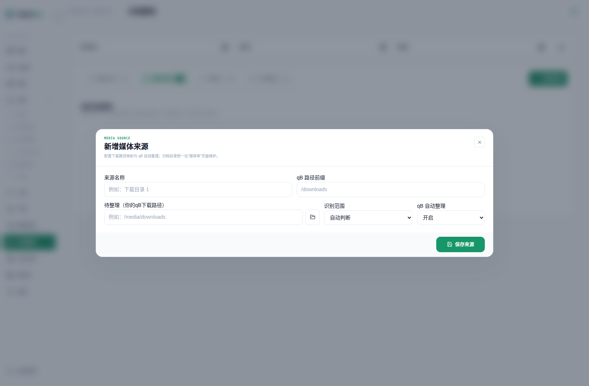


## 6. STRM 同步与播放

### 6.1 来源目录与落盘层级

在“光鸭 → STRM 同步”配置：

- 一个或多个实际光鸭来源目录，不能使用光鸭根目录 ID `0`。
- `STRM_ROOT`：MediaFlux 本地 `.strm` 输出目录。
- `GY_STRM_BASE_URL`：Jellyfin/Emby 和播放器可访问的 MediaFlux 地址。
- 定时同步、元数据、通知和媒体库刷新。

每个来源拥有独立的本地目录，基本层级为：

```text
STRM_ROOT/光鸭云盘/来源隔离目录/来源内的相对目录/视频文件名.strm
```

首次分配通常使用来源名称；重名或路径冲突时会区分目录，已有来源沿用已保存的目录分配。按希望保留的媒体目录层级选择来源；媒体服务器路径映射与云盘扫描来源分别配置。Jellyfin/Emby 需能读取生成目录，并能访问 STRM 中的播放服务地址；容器之间的可见路径在“媒体库与路径映射”中维护。

### 6.2 同步与媒体库刷新

整理联动与页面“快速同步”处理持久化变化队列；手动“完整校准”、`/sync_gy` 和 Cron 定时任务遍历配置来源。远端外部删除、改名、etag/大小变化会在完整校准时通过持久化索引更新或清理本地镜像。

修改播放服务地址并保存后，需要执行完整校准，才能批量改写已有 STRM；页面提供“完整刷新”入口。地址自动探测只发现本机候选地址，不代表已经验证 Jellyfin/Emby 能访问。

整理、STRM 生成和媒体服务器扫描是不同阶段。开启刷新联动后，变化会交给持久化后台刷新队列合并处理；“已排队”或“已交接后台刷新”不表示 Jellyfin/Emby 已完成扫描，更不等于播放器已经可以起播。请结合 STRM、刷新日志和媒体库实际内容核对。

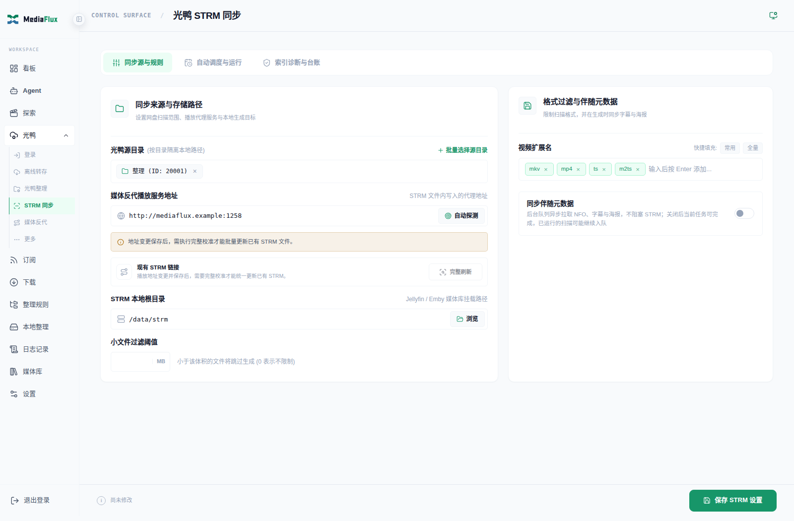

### 6.3 媒体反代与手动播放映射

进入“光鸭 → 媒体反代”（`/guangya/media-proxy`），目前只有两个页签：

- **实例与上游**：复用看板配置的媒体服务器，或设置自定义上游；为实例配置监听地址和端口，查看、测试或编辑实例。
- **播放链路记录**：按实例、状态和来源筛选已记录的播放会话，展开查看请求、阶段耗时与错误。记录是尽力采集的代理链路证据，不代表媒体服务器的全部播放。

媒体客户端通过对应实例的反代地址连接 Jellyfin/Emby。STRM 设置中的“媒体反代播放服务地址”用于生成文件里的播放链接，需分别按实际部署填写。

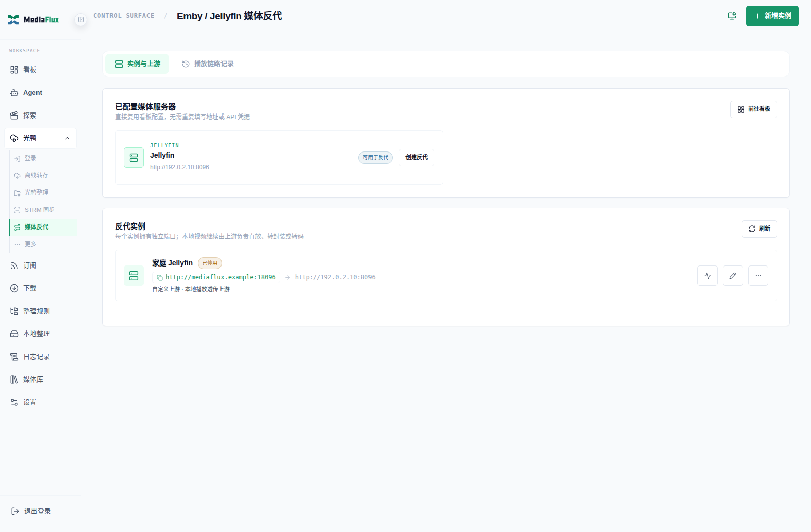

标准 STRM 可以自动识别播放来源。需要人工指定时，在对应实例卡片的 **⋯（更多操作）→ 手动播放映射** 打开列表，再点“新增映射”，填写媒体项目 ID、按需填写的媒体源 ID 和光鸭文件 ID。映射只作用于当前实例；媒体源 ID 留空仅适用于已经核对的单媒体源项目，不会通配接管多版本项目。

有效的人工映射优先于自动识别；本地媒体仍由上游处理。删除映射不会删除光鸭文件。列表读取失败时会显示原因，可点击“刷新”重试。原 `#advanced` 链接会回到实例页，不会替你选择实例或打开映射表单。

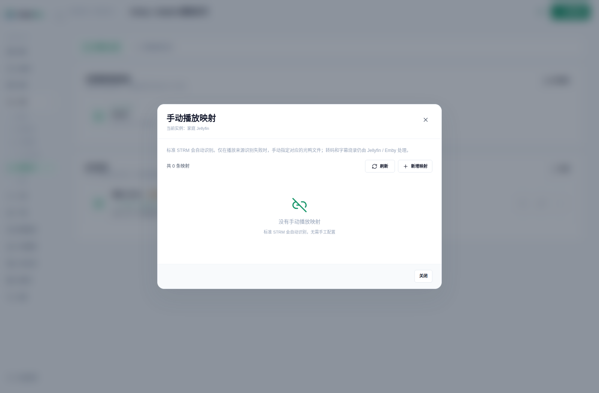

### 6.4 关闭伴随同步后清除积压

关闭伴随元数据同步会暂停消费，但不会自动删除以前登记的 NFO、字幕、海报待办。如果已经不需要这批任务，可以在“光鸭 → STRM 同步 → 调度与运行状态”点击 **清除待办**，核对数量后确认；同步关闭时也能操作，无需重新开启。

- 只取消预览中的排队、等待重试任务，保留取消记录。
- 不删除已经落盘的 NFO、字幕、海报、STRM 或媒体文件，不影响 Jellyfin/Emby 已补全的信息，也不改变同步开关。
- 不中断正在处理的任务；预览后新增的任务不在本次范围。原待办状态发生变化时，需要重新预览。
- 以后重新开启并扫描，可能再次产生待办。若不再需要伴随文件，请继续保持同步关闭。

## 7. RSS 与下载

- `/rss` 添加 Mikan 等订阅、刷新条目并提交单个或批量下载。
- `/downloads` 查看 qB/光鸭进度、失败、待处理和历史。
- 批量操作支持启动、停止和删除。
- 待处理只显示下载失败、部分下载通道失败或提交结果待核对的请求，可重新投递到光鸭、qB 或两者，也可清除本条待处理状态。已下载成功后的整理、STRM 和暂存目录清理问题保留在请求详情及相应日志中，不提示重复下载。
- 下载日志会显示后续整理、同步或清理的问题。因路径映射等原因未能建立本地整理任务时，可在对应日志点击“重试本地整理”，仅重新排队整理，不重新下载；已建立的任务仍在“本地整理”页面处理。

### 下载默认值与继承

“设置 → 下载器”中统一配置 qB 连接和下载分类；保存路径在具体订阅中选择：

- **RSS**：每条订阅明确选择 qBittorrent 或光鸭，仅显示相应的路径或目录字段。qB 保存路径留空使用 qB 自身的下载路径，填写后使用指定路径；未配置 qB 时，保存会弹窗提示并提供“前往配置”和“返回修改”。光鸭未选择目录时显示离线转存默认目录，没有默认目录则提示“未配置”。
- **下载分类**：Telegram、资源站和 RSS 共用设置页的一项 qB 分类。填写分类名就使用该分类，留空不指定；Bot 和资源站的保存路径交给 qB。
- **光鸭目录**：普通下载默认目录在“光鸭 → 离线转存”设置。RSS 表单显示继承目录名称及 ID，也可为订阅选择独立目录。选择 qB 的路径不会改变光鸭目标目录。

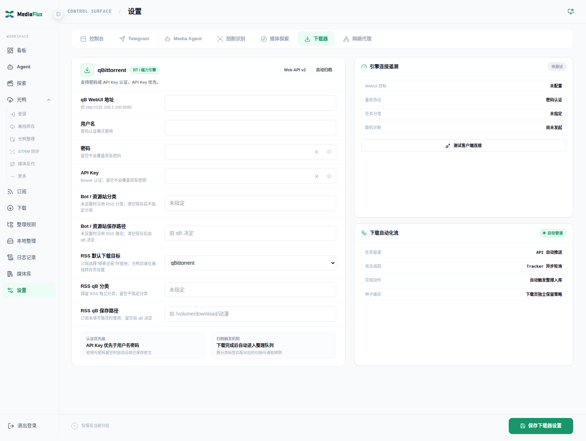
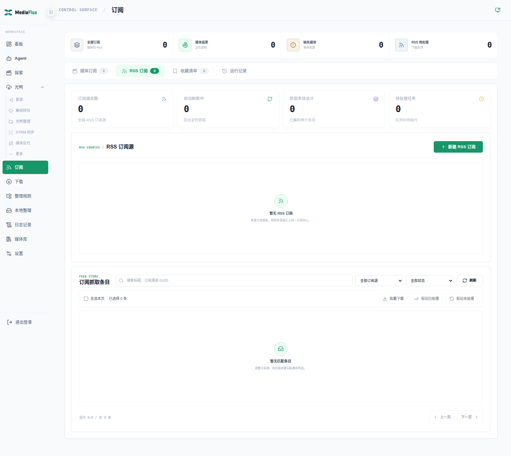
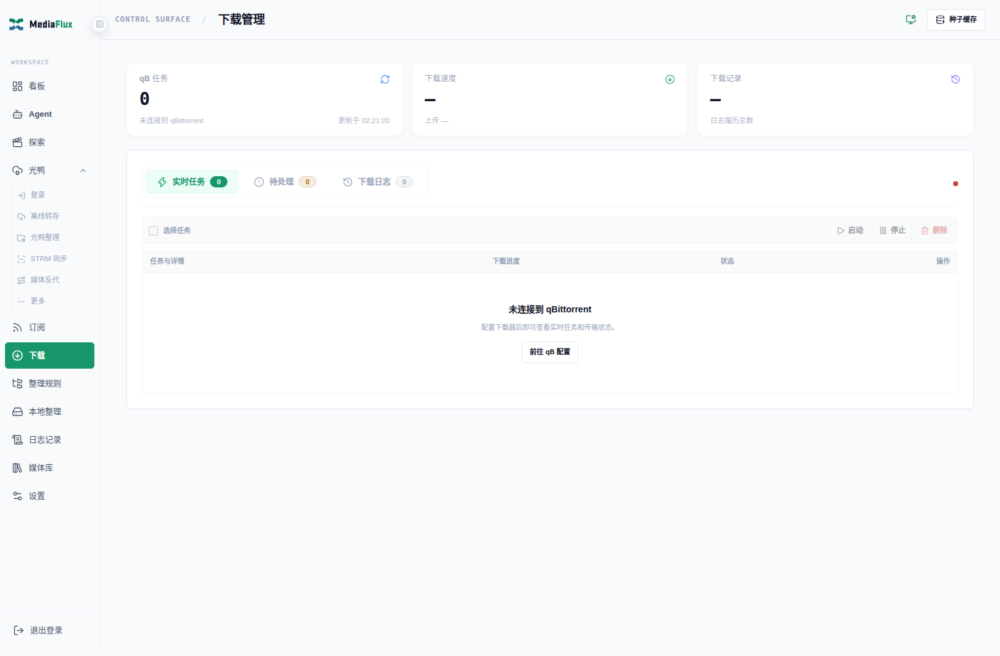

## 8. Telegram Bot

在“设置 → Telegram”配置 Bot Token、允许使用的账号和通知目标；Telegram Agent 还有独立开关，需同时开启 Media Agent 总开关。普通下载选择和人工确认不要求开启 Agent。

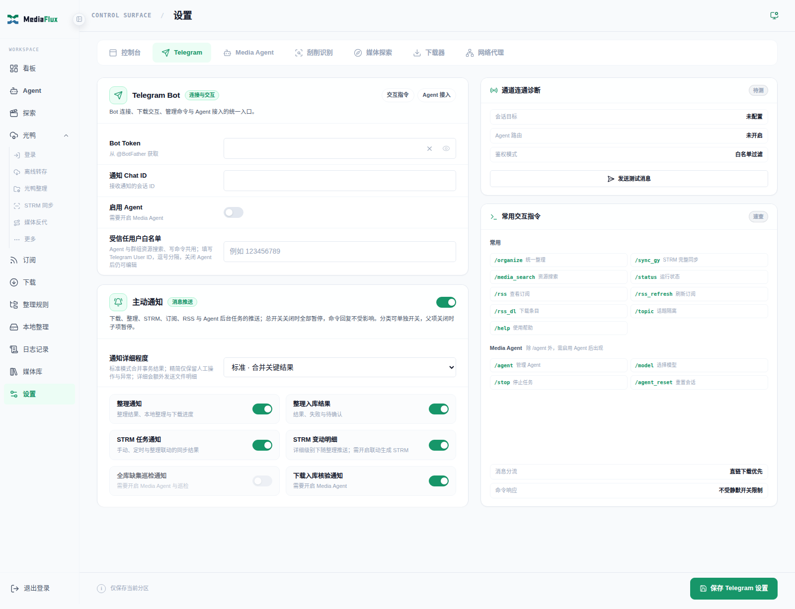

常用命令：

| 命令 | 功能 |
| --- | --- |
| `/start` | 查看帮助 |
| `/sync_gy` | 并发扫描全部来源并完整校准 STRM |
| `/media_search 片名` | 搜索媒体资源 |
| `/媒体搜索 片名` | 中文别名 |
| `/rss` | 查看订阅 |
| `/rss_refresh ID` | 刷新订阅 |
| `/rss_dl ID` | 下载条目 |
| `/status` | 查看系统状态 |
| `/agent` | 始终可用；查看状态并开启/关闭 Telegram Agent 或全部 Media Agent |
| `/agent_reset` | Agent 已启用时重置当前会话与待确认操作 |
| `/topic`、`/topic on`、`/topic off` | 查看/切换私聊话题的应用会话隔离；开启前需在 BotFather 启用私聊话题 |
| `/model` | 查看当前渠道模型，点击按钮切换当前会话后续回合；不改变 Web 或其他话题的模型 |
| `/stop` | 停止当前会话规划、撤销待确认计划，并请求停止可安全取消的关联后台任务 |

话题隔离开关不控制 Telegram 平台本身；无论隔离是否开启，回复与下载选择按钮都保留原消息的话题。`/topic` 按钮切换成功后会收起，只保留状态回执。`/model` 使用双列分页菜单，每页最多 8 个模型；选中模型或取消后收起按钮，翻页不会切换模型，取消不会改变当前模型。模型列表菜单过期或模型渠道配置改变后，请重新执行 `/model`。

开启私聊话题隔离后，新建且由 Telegram 标记为默认名称的话题，会在 Agent 首次有效回复后按消息主题自动命名一次，使用当前会话选择的模型。你手动命名的话题、缺少创建记录的旧话题不会被覆盖；命名失败不影响正文和确认卡，也不会每轮反复请求模型改名。

`/stop` 不会关闭服务或终止其他会话。“停止请求已受理”不等于后台任务已终止；已受理且无取消接口的云端任务、未提供单任务取消接口的 STRM/本地扫描会明确显示为不可取消，原子写操作先完成安全步骤再停止会话续行，已提交任务仍保留结果跟踪。

`/sync_gy` 完成后会按云盘来源分别发送目录 ID、本地同步目录、扫描文件、STRM 新建/更新、清理内容和阶段耗时，最后再发送一条全部来源汇总。

确认执行 STRM、网盘整理、RSS 刷新或下载操作后，原确认卡会立即移除按钮并在任务接纳后自动清理；即使 Telegram 无法删除旧消息，也会保留明确的“已确认/未启动/已失效”状态，避免再次进入 Bot 时误以为任务尚未提交。

直接发送磁力、ED2K、可识别的 HTTP(S) 下载链接或 `.torrent`，Bot 会显示下载目标；普通网页不会被当成下载直链提交。

| 目标 | 实际行为 |
| --- | --- |
| 光鸭·默认目录名称 | 下载到“离线转存”中配置的普通默认目录，按钮显示当前目录名。 |
| qBittorrent | 提交到 qB，使用统一下载分类和 qB 自身的保存路径。 |
| 光鸭·NSFW · 来源名称 | 只提交到对应的 NSFW 整理来源；多来源分别选择。未配置来源或原来源已变更时，不会静默改投普通目录。 |
| 光鸭·默认目录名称 + qBittorrent | 同时提交普通光鸭目标和 qB，分别记录通道结果；一个成功不代表两个都成功。 |

NSFW 目标不与“普通光鸭 + qB”组合混用。可提交的资源还受协议、下载器配置及规则校验约束；失败会返回具体原因。

人工确认会以候选按钮进入队列；点击后只提交选择，不要求等待上一个目录完成。剧集通知按媒体/季汇总，并显示本次集数、全季进度和缺集信息。

## 9. 媒体探索与资源搜索

在“设置 → 媒体探索”的“页面显示”中，三个开关分别控制 Web 媒体探索入口、媒体档案中的多站资源索引，以及探索页和全局搜索的豆瓣来源。它们只影响 Web 展示及相应页面接口，不关闭 Agent、Telegram 或 RSS 的相关能力，也不影响已归档媒体。

资源站点勾选范围用于媒体档案、Telegram 与订阅；Agent 检索全部公共站点，Sukebei 需单独授权。站点标签可筛选右侧结果；失败站点会显示具体原因。资源默认按发布时间从新到旧，可批量推送到 qB、光鸭或两者。追漫日历汇总当前可用平台的周播信息，实际覆盖范围以页面来源状态为准。

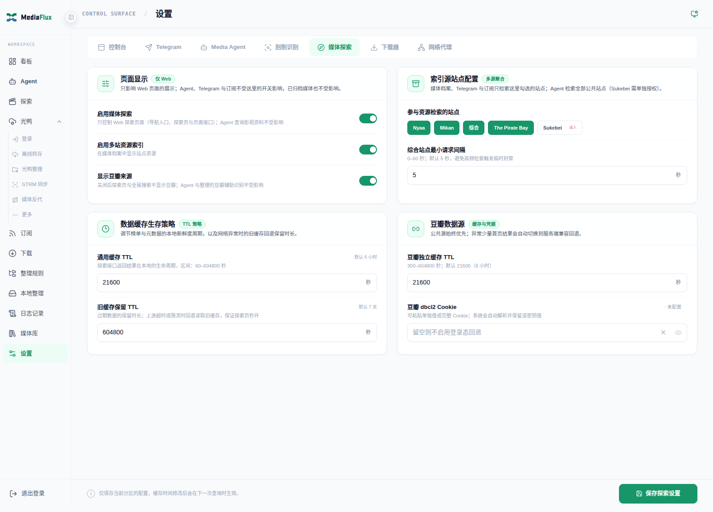

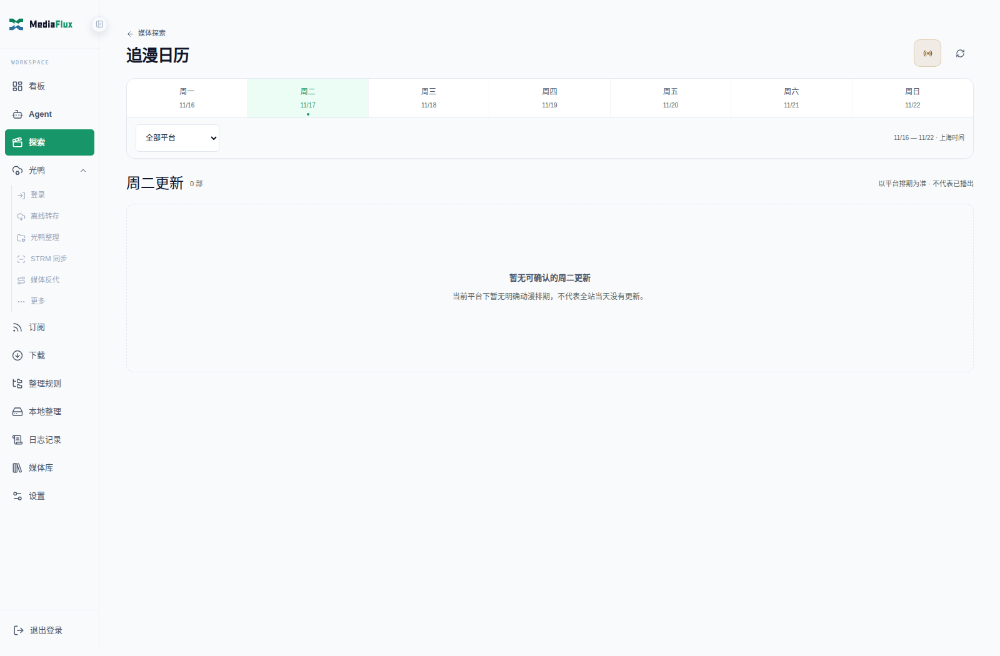

最近入库与全局搜索不占用侧栏入口，通过看板顶栏访问：


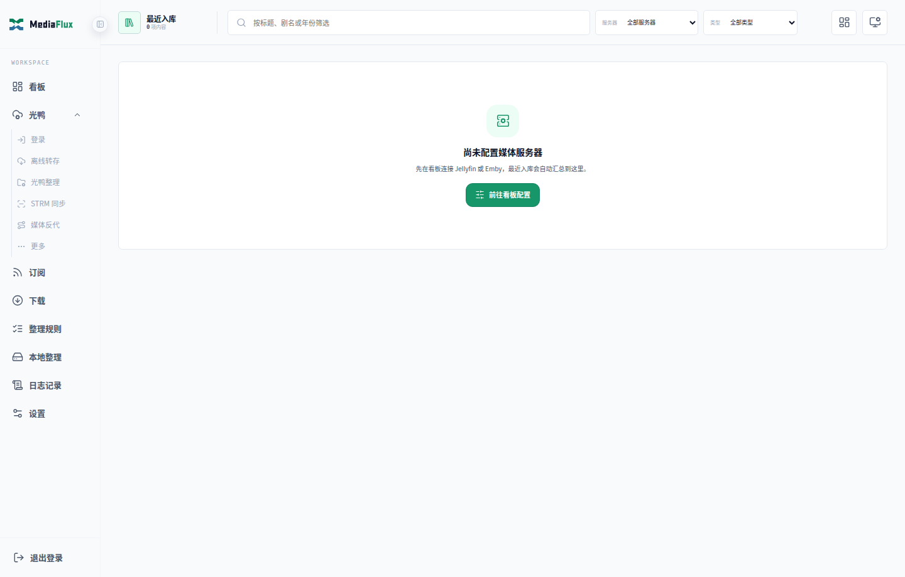

## 10. 日志与纠偏

`/logs` 包含：

- 整理日志：光鸭和本地来源标志、状态筛选、详情、重新识别、回退和移入回收站。
- “版本与优先级策略”中的“自动回收同版本落选文件”默认开启。光鸭整理确认同版本并按冲突策略保留现有归档时，会自动将来源新文件及其专属伴随文件移入光鸭回收站，日志显示“已回收”；关闭后只跳过并保留新文件，仍可在整理日志中手动批量回收。同一批次的胜出文件先完成归档并通过回读核验，再回收落选文件；预览、识别不确定、待确认、已在归档目录的文件及允许共存的不同版本不会触发此操作。
- 自动回收后，即使关闭普通“空目录清理”，也会清理这次回收产生的空目录链；属于已完成下载请求的，还会核验并清理直到该请求的 `MF-…` 暂存根。非空目录、共用伴随文件、公共下载目录、来源根和归档根保留。回收失败会留下明确失败记录，不会把未完成操作显示为已回收；历史跳过记录仍可使用已有“批量移入光鸭回收站”。
- 开关保存后用于后续整理任务，运行中的任务沿用启动时的规则；如需停止当前回收，请先停止整理。已成功回收产生的空目录仍会继续完成收尾。
- 从整理日志移入光鸭回收站时，开启“整理联动 STRM”后只清理已确认删除对象关联的受管 STRM、元数据及索引，不触发全来源同步；未关联 STRM 的文件无需同步。本地内容被修改、路径被其他对象共享等情况会保留文件，需处理的收尾异常会显示在操作结果中。直接在云盘 App 删除的外部变更仍通过定时或手动同步校准。
- 实时日志：应用运行日志与规范化异常。

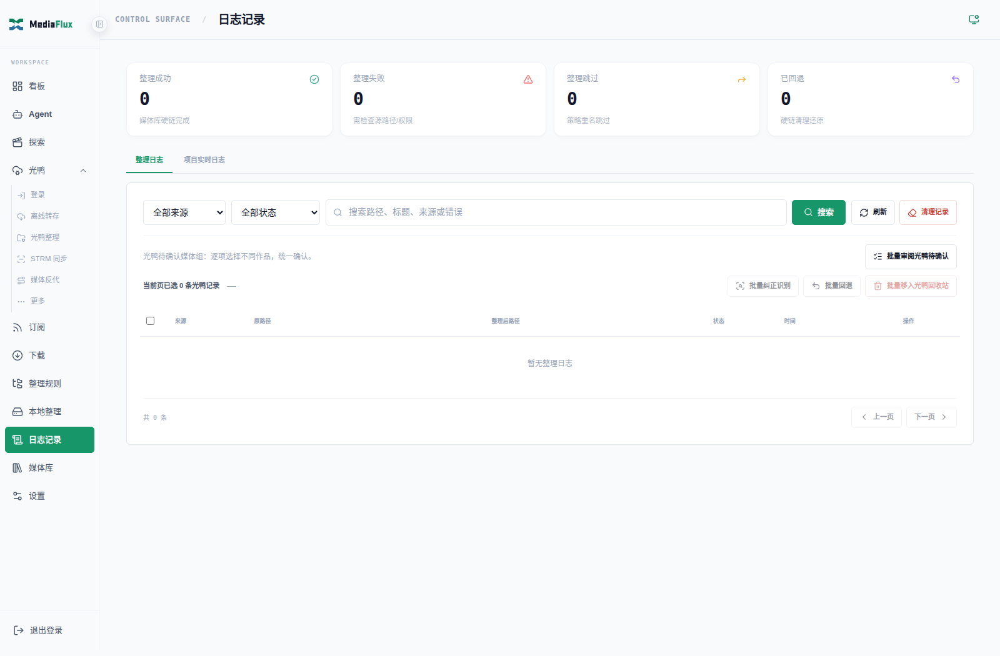

人工纠正形成的 TMDB 映射锁可在“设置 → 刮削识别”管理，只在对应文件名、父目录、媒体类型和季号等上下文内命中；发布格式解析不等于身份锁定。单个媒体的解析与候选核对可在整理日志详情中完成。

### 批量审阅光鸭待确认

整理日志中的“批量审阅光鸭待确认”按媒体组展示当前有效候选。可按整理任务、来源、待确认原因和关键词筛选，勾选本页或全选匹配结果，跨页保留选择；每批最多 1000 组。

1. 点击“Agent 只读复核”生成各组建议；需启用 Agent 识别复核并配置模型。此步骤不移动、改名或整理文件。
2. 证据不足的组可逐项查看候选差异，使用“保存并下一条”保存人工选择。关闭 Agent 或 TG 也能使用网页人工审阅。
3. 点击“预览所选”，核对各自作品、文件及媒体目录，再点击“确认并后台整理”。没有建议、未保存选择及已处理的组不会一并提交。
4. 在当前批次查看逐项进度；刷新页面会恢复本次选择和批次，最终状态以服务器记录为准。提交后无需重复点击；失败或过期项目需核对原记录，不能把“已入队”当作入库完成。

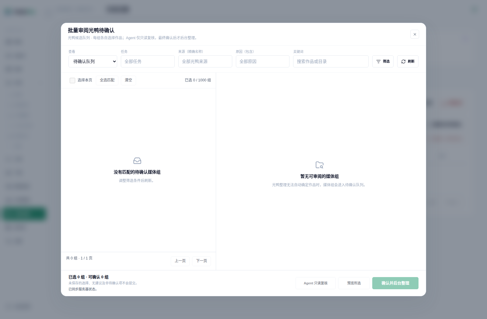

同一次整理产生多组待确认时，TG 使用一张可更新摘要，支持分页查看、逐组选择，并可一键确认整批已核验的建议：只包含通过服务器确定性复核的 Agent 建议和你已保存的人工选择，没有建议的组仍需逐组选择；单组核验未通过时只剔除该组并在摘要中说明原因。涉及季集重新映射的建议需在网页查看完整对应关系后确认；超过 1000 组的批次也请在网页分批处理。网页、TG 与 Agent 共用同一候选队列，任一入口处理后其他入口会同步状态。候选仍保留原有效期，过期后需要重新整理生成；旧的“批量纠正识别”继续用于多条记录统一到同一个作品身份。

摘要中的“整理完成”与后续 STRM、媒体库状态分开显示。STRM 完成且刷新已持久入队时，摘要可显示“已交接后台刷新”；这不是缺少回执，也不代表媒体服务器扫描已经完成。

## 11. Media Agent

在“设置 → Media Agent”开启总开关，配置模型服务地址、模型名及服务要求的 API Key。总开关默认关闭，AI 回退、主动复核、Telegram Agent 和后台巡检还需各自启用；关闭父级开关时保留子项配置，但不让子功能生效。普通网页人工操作和 Bot 下载不依赖 Agent。

模型通道支持 Responses API / Chat Completions。获取模型列表只读取 `/models`，测试连接会发送不含业务数据的最小能力探测；列表可用不代表模型调用、业务服务连接或额度都已验证。

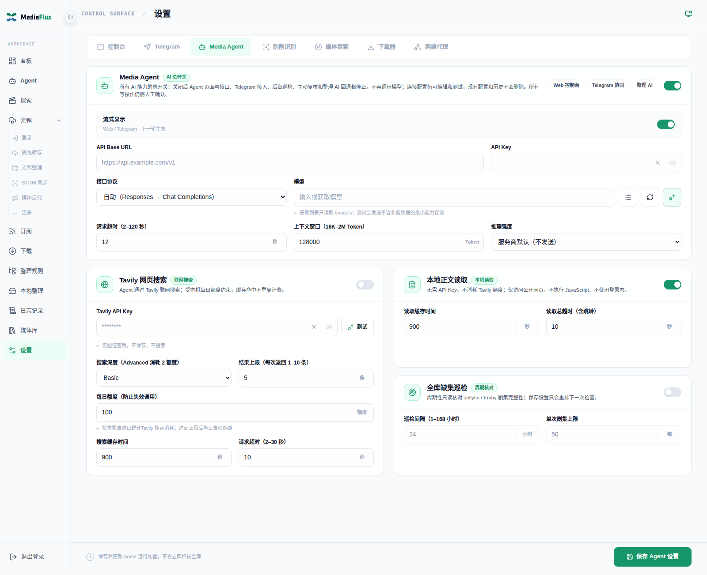
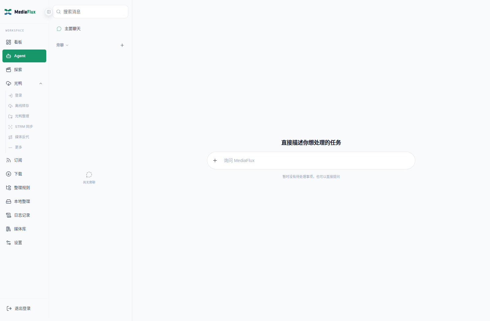

- **工作区与 SDK**：模型在隔离工作区使用 Python / Shell，通过内置 `mf` SDK 读取和组织业务结果；业务调用沿用项目服务。工作区不直接获得主机凭据或正式媒体文件访问权限；工作区不可用时会明确报错。
- **确认范围**：下载、转存、整理、删除、配置与规则变更等需确认的操作，会先冻结目标和参数并展示确认卡；确认、取消走确定性入口。只读查询、工作区本地文件操作，以及指定媒体库/单项刷新等免确认能力，不要求每次再弹确认卡。
- **已授权的自动行为**：开启自动下载、自动整理或主动复核后，相应范围内的后续处理按其策略执行。确认卡或回执会说明自动范围；预览和候选选择本身不等于已经提交下载或整理。
- **关闭总开关**：停止 Web/Telegram Agent 及依赖它的后台 AI 能力，保留配置与历史。已经提交给下载器或整理队列的业务任务不因此自动撤销，需按原任务的停止或取消方式处理。

### Web 对话操作

- **从当前待办开始**：首页最多显示三个基于本地记录的安全入口，点击只填入问题，不会自动整理或下载。没有待办或暂不可用时，仍可直接提问。
- **等待时继续编辑**：Agent 回复过程中可以准备下一句话，但不会自动排队发送。未发送草稿按账号和会话隔离，仅保存在当前浏览器标签页，六小时后过期；疑似凭据不会持久保存。清空输入或删除会话会清除相应草稿，关闭标签页后不保证保留。
- **对比资源后再确认**：搜索结果有安全候选时，可比较版本、来源、匹配理由和警告，点击“选择并预览”进入原确认流程。选用候选不会覆盖输入框里正在编辑的草稿，也不等于立即下载；过期或已被新搜索替换的候选需要重新搜索，不能盲目重试旧卡片。
- **主要聊天与旁聊**：左侧会话栏固定有一个“主要聊天”，打开页面默认进入；首次使用时沿用最近一次会话，之后不随新会话改变，也不能删除。其他会话归入“旁聊”，可用 + 新建。旁聊悬停时显示最近活动时间及“…”菜单，可重命名、置顶或删除；手机上直接显示菜单按钮。顶部“搜索消息”按正文检索主要聊天、旁聊与 Telegram 会话，返回命中片段。窄屏下会话栏收在顶栏的会话按钮里。
- **查看 Telegram 会话**：会话栏的“Telegram”列出 Telegram 白名单账号的 Agent 会话（含话题），只能查看，需要继续对话请回到 Telegram。
- **回复某条回复**：把鼠标移到回复上（触屏常显）点“回复”，输入框上方会显示“正在回复”，发送时引用的正文会作为参考一起交给 Agent。
- **添加种子或磁力链接**：点输入框左侧的 + 选择 .torrent 文件，或直接把磁力链接粘贴进输入框，页面会生成下载卡片；选择 qBittorrent、光鸭或两者后提交。这一步不经过模型，与在 Telegram 发送种子文件走同一条下载链路。
- **保留阅读位置**：向上查看旧内容时，新回复不会强行拉到底部；输入框上方会显示下方还有几条消息，点击即可回到底部。输入框有内容时才显示发送按钮。普通请求失败时可以把问题放回输入框修改，不会自动重发写操作。

### 11.1 常见需求

| 可以这样说 | 实际行为 |
| --- | --- |
| “查这部真人剧的主演和角色。” | 区分作品与季后读取 TMDB 演职员详情；未查询、缺字段、空结果和请求失败分别说明，不能从搜索概况推断官方没有演员表。 |
| “这组文件名应这样识别，先演示；确认后再记住。” | 提供 2–8 个真实样本及正确标题、原始季集，至少包含两个不同集号；先做发布格式只读预览，明确要求保存后再确认。不会据此自动锁定 TMDB 或改写季集映射。 |
| “清除已关闭同步的元数据积压，不要重新开启同步。” | 预览待办数量，确认后取消冻结范围内的排队/重试任务，保留已有文件和同步开关。 |
| “元数据队列现在还在运行吗？” | 同时查看同步开关、积压和当前进程消费者状态，不把瞬间运行数为零解释为消费者已经永久停止。 |
| “昨天那个下载为什么还没入库？” | 查找活动并按真实请求/运行标识展示下载、整理、STRM 和媒体库复核记录；同名任务不会被猜测合并。 |
| “帮我盯住这个任务，结束或出问题告诉我。” | 确认后保存跟踪，约每 5 分钟检查已有记录；异常、阶段结束或到期时通知一次并停用。不重试、不取消原任务。 |
| “不用再跟踪这个了。” | 查询我的跟踪规则，确认停用；已经进入通知队列的消息不会被撤回。 |
| “以后优先 4K、HEVC 和中文字幕，下载默认走 qB。” | 确认保存当前身份的结构化偏好。画质/语言参与缺集资源排序；题材、评分及观看状态参与本地推荐；未指定下载目标时在预检阶段选定并冻结默认目标。 |
| “从我的库里推荐没看过的轻松喜剧。” | 在媒体服务器返回的真实候选中筛选，不把外网片单冒充本地库存。单次明确的过滤参数优先于已保存偏好。 |
| “看看动漫库哪些视频低于 1080p、缺中文字幕。” | 分页质量检查，报告范围、下一页和未知字段；只在本页检查疑似重复，不宣称全库查重或探测过 STRM 可播放性。 |
| “收藏这部电影”“把这个视频标记未看。” | 核对真实用户和媒体条目状态，生成确认计划，执行后回读验证。整部剧集不会被隐式展开批量标记已看。 |
| “把这几部电影加进周末看片列表。” | 查找已有列表并核对成员；确认后加入，跳过已有成员。移出列表只移除成员，不删除媒体文件。 |
| “每周检查一下这部剧，有资源先让我确认。” | 创建既有媒体追更订阅并明确动作、目标、站点及检查间隔；目前支持每 3 天或 7 天，不等同于固定星期几运行。 |
| “每天晚上九点给我摘要，只报异常。” | 确认后保存本地时区的每日摘要，复用项目 Telegram 通知中心；不定时调用模型生成总结。 |

偏好是排序和推荐依据，不是自动化规则的硬筛选承诺。通用索引搜索指定了“最新发布”等排序时仍遵循该搜索条件；光鸭分享只能转存到光鸭，不会因 qB 偏好改道。配置自动追更 `auto` 策略时，确认卡会说明后续匹配资源无需逐次确认；不接受或静默忽略尚未支持的独立 4K/字幕硬筛选字段。

### 11.2 配置与安全撤销

Agent 可管理的配置包括本地媒体来源、发布组/尾部制作组识别知识、输入发布格式，以及 Jellyfin/Emby 路径前缀映射。相关业务变更经预览与确认，复用 Web 的领域服务；新建本地来源默认仅预览并关闭 qB 自动接管。路径映射不负责选择 STRM 云盘扫描来源，也不负责本地分类媒体库归档绑定。

- **媒体偏好保存后撤销**：使用该操作返回的回退凭证，确认恢复之前的值；中间存在新写入、清除后重新创建等情况，旧凭证失效。清除偏好本身不提供通用撤销凭证。
- **光鸭整理回退**：只支持整理日志中有完整操作快照、现有业务回退服务允许的最近移动/改名。确认后进入原整理执行队列；“已接收”不表示回退成功。
- **不支持假撤销**：永久删除、已经投递的通知、已经提交的下载，以及缺乏反向快照的文件操作，不承诺可恢复。普通设置仍可用其原修改工具明确改回，但不会伪装成有快照保证的撤销。

### 11.3 通知、身份与已知边界

- 主动摘要和跟踪默认未开启，只能通过确认保存。关闭 Agent 总开关后停止新检查/投递，保留规则；TG 身份撤权或通知目标改变时不会改投其他聊天。
- 跟踪读取的是持久化任务记录，不是下载器实时测速；缺少媒体库复核记录时会明确提示，不能把“下载结束”当作“已入库”。
- Jellyfin 新建播放列表要求配置明确媒体用户，默认私有。Emby 可读取及修改已有列表；不能可靠确认新列表所有者时拒绝创建。
- 质量检查缺少字幕/视频字段时返回“未知”，不会将未知判为合格，也不会自动清理低画质或重复文件。
- STRM 云盘扫描来源、本地分类归档绑定和 TMDB 映射锁的增删改仍使用 Web 页面。Agent 可查询、启停已有预处理、TMDB 强制匹配和发布格式规则；预处理及 TMDB 强制匹配规则的内容编辑仍在 Web 完成。固定星期的媒体追更和每规则独立画质/字幕硬筛选也不在当前自动规则范围内。

## 12. 移动端

主要页面支持移动端导航与表单布局。复杂整理和大量候选预览仍建议使用桌面端。

| 看板 | 整理 | RSS | Agent |
| --- | --- | --- | --- |
| 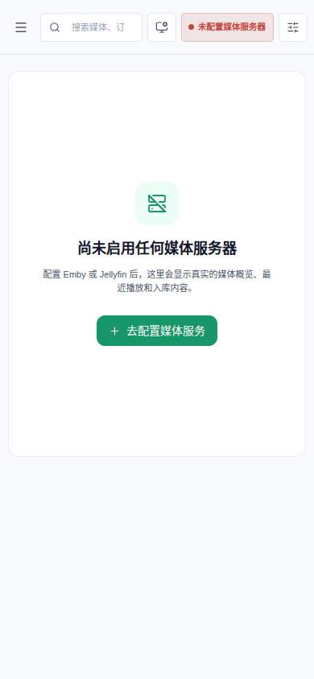 | 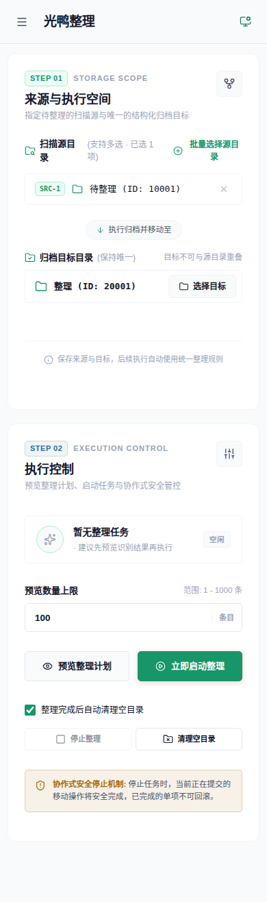 | 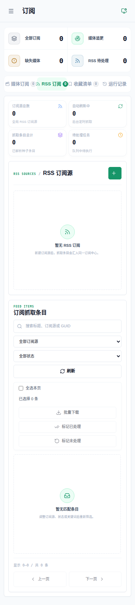 |  |
