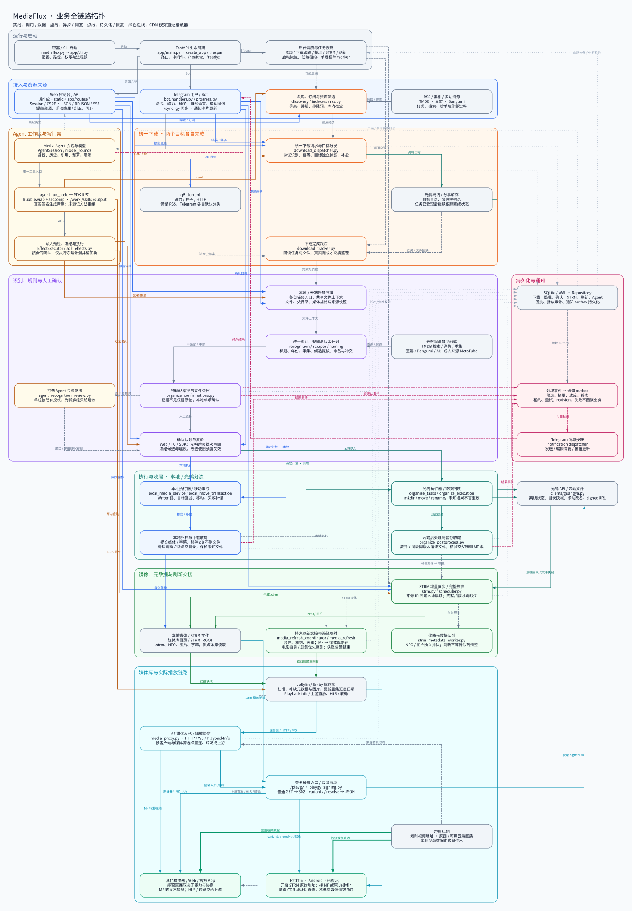
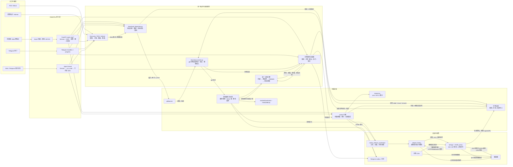
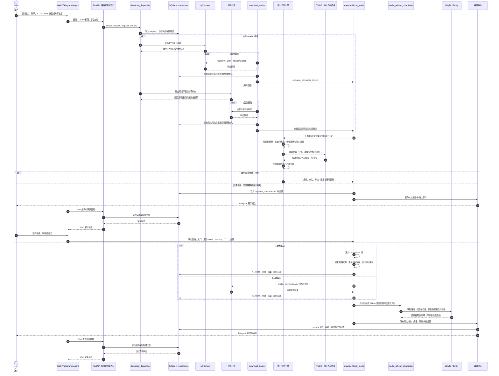
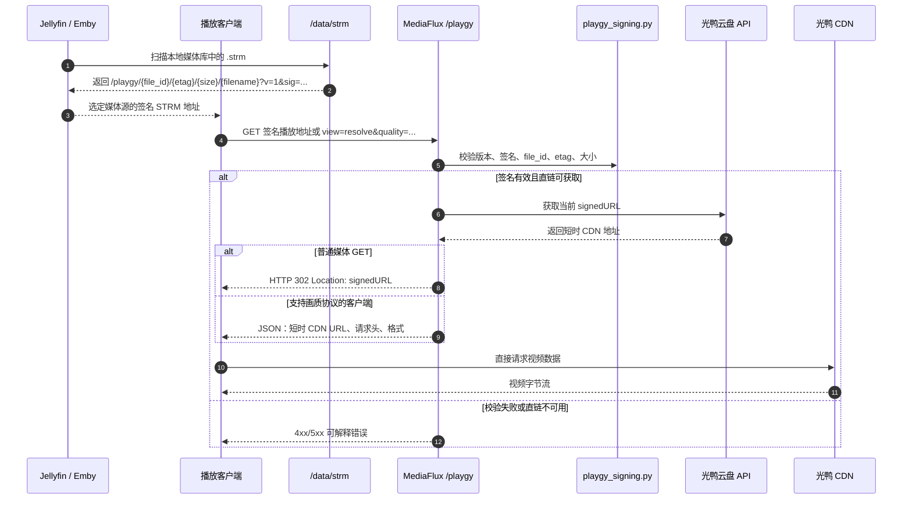
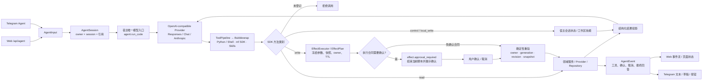
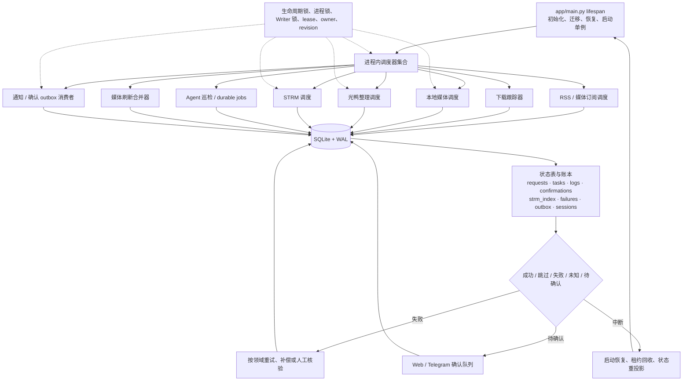
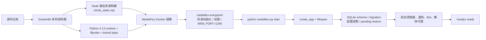

# MediaFlux 项目完整全链路流转拓扑图

> 更新日期：2026-11-17<br>
> 适用基线：当前工作区 `main`（不改变业务代码）<br>
> 目的：把 MediaFlux 从启动、入口接入、资源发现、下载、识别、整理、STRM 播放、媒体库刷新、通知到持久化恢复的主要流转，收敛成一份可维护、可追溯的拓扑视图。

## 0. 快速查看

### 业务连通总图



- **放大查看**：[`architecture/mediaflux-full-chain-topology.svg`](architecture/mediaflux-full-chain-topology.svg)
- **可维护源图**：[`architecture/mediaflux-full-chain-topology.dot`](architecture/mediaflux-full-chain-topology.dot)
- **相关开发文档**：[`开发文档.md`](开发文档.md)；[模块地图](模块地图.md)
- **用户侧流程教程**：[`tutorials/00_自动化流转全景与工作流程.md`](tutorials/00_自动化流转全景与工作流程.md)

沿箭头从上向下阅读主干：**发现 / 提交 → qB 或光鸭下载 → 完成跟踪 → 识别与确认 → 本地或云端执行 → STRM / 媒体库刷新 → 播放**。Agent、人工确认、云盘 API、持久化与通知都用实际连线接入主干，不再用跨区编号替代。

实线表示调用或数据流，虚线表示异步交接或调度，点线表示持久化与恢复；绿色粗线表示 **CDN 视频直接传到播放器**。节点内列出职责与主要模块，图中的相邻位置不代表调用关系，以箭头为准。

播放部分单独标出已验证的 **Pathfin 安卓客户端**：它可连接 MF 反代或原 Jellyfin，通过画质协议取得 CDN 地址后直连。**直连描述的是视频流向，不等于所有入口都必须返回 HTTP 302。** 设置与网络条件见[云盘画质协议](strm-cloud-quality.md)。

下方时序图展开请求、回读和回调关系。

## 1. 一句话总览

```text
Docker/CLI 启动
  → FastAPI + Uvicorn 单 Worker
  → Web / Telegram / Agent / RSS / Indexer 等入口
  → 统一下载请求与状态跟踪
  → qBittorrent 本地分支 或 光鸭云盘分支
  → 统一识别、命名、分类、冲突和人工确认
  → 本地移动事务 或 光鸭远端整理
  → 本地媒体库刷新 或 STRM 增量同步
  → Jellyfin / Emby 扫描；播放按客户端能力选择云盘直连、MF 转发或上游转码
  → Telegram / Web / 日志输出
  → SQLite、outbox、失败账本、锁与恢复机制闭环
```

核心原则：

1. **入口统一**：Web、Telegram、RSS、Indexer、Agent 最终进入共享领域服务，不各自维护一套下载或整理实现。
2. **本地与云端共用识别**：标题预处理、TMDB/外部线索、季集推断、命名、版本与冲突策略统一；存储事务分别由本地移动和光鸭远端写入负责。
3. **预览与执行分离**：预览只生成候选/计划；真实写入需要执行入口、确认票据或确定性业务动作，并重新读取最新快照。
4. **状态先落库再扩散**：下载、整理、STRM、刷新、通知均有持久状态；异常按各自策略重试、人工处理或恢复；媒体库自动刷新服务失败记录原因后结束，不靠内存猜测成功。
5. **单进程单 Worker**：后台调度器、Telegram Polling、整理任务、媒体代理和写入锁均是进程内/跨进程协调的关键组成。

## 2. 主拓扑：从入口到媒体库



### 2.1 两条业务主分支

| 分支 | 触发与状态 | 写入结果 | 后续联动 |
| --- | --- | --- | --- |
| **qBittorrent → 本地** | qB 真实完成后由 `download_tracker` 创建本地媒体任务 | `local_media_service` 重新扫描、识别、冲突仲裁，再由 `local_move_transaction` 提交 | 本地媒体库刷新；按规则做 qB 收尾和高置信垃圾清理 |
| **光鸭 → 云端/STRM** | 光鸭离线/分享任务真实完成后进入云端整理 | `organize`/`organize_tasks` 通过光鸭客户端执行远端目录创建、移动、改名；`strm.py` 生成本地指针 | STRM 索引与增量同步；Jellyfin/Emby 刷新；播放时经签名入口取得 CDN 地址（302 或画质 JSON） |
| **双目标 `both`** | 同一下载请求分别记录 qB 与光鸭目标状态 | 只补投失败/缺失目标，不重复已成功目标 | 两条分支各自完成后，再分别进入本地/云端后处理 |

## 3. 典型入库时序：提交 → 下载 → 识别 → 整理 → 刷新 → 通知



### 3.1 重要时序语义

- 下载请求是**按目标独立记录**的：qB 成功不代表光鸭成功，反之亦然。
- `download_tracker` 只在真实完成后触发后续整理；提交结果未知时进入人工核验，不能盲目重复提交。
- 识别结果不直接等于写入：规划、冲突仲裁、最新库存复核和 Writer 提交是分开的阶段。
- 整理后的刷新进入持久化合并队列，避免同一媒体库短时间重复扫描。
- 人工确认与自动整理共用后续刷新链路。路径未匹配、绑定失效或服务失败记录原因后结束本批自动刷新，用户可在媒体服务器中手动刷新；不扩大为全库扫描，也不无限重试旧路径。
- 剧集按整剧合并扫描以更新汇总日期；没有整剧条目时才退到季或目录。全新作品可扫描对应物理根或所属媒体库，不扫描无关库。
- 去重窗口内的新变化延后处理；本地队列存储故障和中断租约继续恢复。整理成功、STRM 完成、刷新已接纳、媒体库已发现内容是不同阶段。
- 通知是终态后的附属副作用；通知失败不应反向改写已经成功提交的媒体结果。

> **触发机制说明**：当前主链路是外部服务状态轮询 + SQLite 持久任务队列 + 执行时目录扫描；未发现 `watchdog`、`watchfiles`、`inotify` 或其它 OS 文件事件监听实现。

## 4. STRM 与云盘直连播放链路



以上展示客户端使用签名 STRM 入口取得 CDN 地址的两条路径。画质客户端先以 `view=variants` 发现可用画质，再以 `view=resolve` 解析选定画质。不同入口的行为如下：

- `/playgy` 的普通 GET：校验签名、取得光鸭直链并返回 302；HEAD 用于探测，`view=variants/resolve` 返回云盘画质 JSON。文件名不参与播放签名，不能把它当作授权身份。
- `media_proxy`：代理 Jellyfin/Emby 的 HTTP/WebSocket；结合客户端和媒体源决定是否 302、MF 转发或继续上游播放链。MF 转发不转码，视频字节会经过 MF；HLS/转封装/转码由上游媒体服务器负责。
- `PlaybackInfo` 是播放协商请求。它的延迟、302 地址取得耗时和视频传输耗时分别记录，不能相互替代；支持的云盘画质发现协议见[云盘画质切换](strm-cloud-quality.md)。

## 5. Media Agent 跨端流转



Agent 业务写入统一通过宿主 SDK 和领域服务；工作区内的笔记与脚本可直接保存：

- Web 与 Telegram 共享同一 Kernel、事件协议和领域 Action。
- `@sdk_method` 是方法分类的唯一来源。读调用经过准入检查；写入先冻结计划，按合同决定是否展示确认卡，免确认写入也有执行回执。确认阶段只执行冻结计划，不重放被中断的脚本。
- 资源候选、分享转存、下载提交和整理确认使用带 TTL 的 opaque ref/快照，防止迟到回合或跨会话串用。
- Agent 总开关及子功能由 `feature_gate` 等准入检查控制；历史与配置保留。Web 探索、豆瓣来源和资源索引展示开关不关闭 Agent/TG/订阅能力。

## 6. 后台调度、持久化与故障闭环



### 6.1 关键持久化对象

| 状态域 | 代表表/目录 | 作用 |
| --- | --- | --- |
| 下载 | `download_requests`、`download_log`、staging 相关表 | 记录来源、qB/光鸭目标状态、重投、未知结果和后处理准入 |
| 整理 | `organize_log`、`organize_log_items`、`organize_operation_steps` | 记录识别、命名、移动、替换、回退和逐文件结果 |
| 确认 | `organize_confirmations`、confirmation delivery outbox | 保存候选、目录指纹、TTL、Telegram/Web 关联和一次性执行权 |
| 本地媒体 | `local_media_sources`、`local_media_tasks`、operation steps | 来源、目标、扫描、Writer 任务和事务状态 |
| STRM | `strm_index`、`strm_failures`、`strm_retired_sources`、`/data/strm` | 远端文件映射、增量指针、失败重试和来源退役 |
| 通知 | `telegram_notification_outbox`、`media_subscription_notification_outbox` | 事件去重、领取租约、重试、送达和跨重启恢复 |
| Agent | `agent_*` 表与加密引用 | 会话、事件、动作历史、EffectPlan、额度、巡检和补偿凭证 |
| 代理/播放 | `media_proxy_*` | 代理实例、绑定、PlaybackInfo 处理和播放审计 |
| 运维 | `user.env`、cache、logs、backup | 配置、缓存、运行日志、备份、迁移与恢复 |

## 7. 部署与启动链路



- 官方 Compose 将 `./data` 挂载到 `/app/db`，`./strm` 挂载到 `/data/strm`，并挂载下载目录和媒体库目录。
- 生产运行必须保持一个 MediaFlux 进程、一个 Uvicorn Worker，避免调度器、Telegram Polling、写锁和数据库状态被重复占用。
- `healthz` 表示 HTTP 服务可响应；`readyz` 表示 lifespan 初始化与后台运行时已进入 ready 状态。

## 8. 源码锚点

| 拓扑节点 | 源码锚点 | 责任 |
| --- | --- | --- |
| 启动入口 | `mediaflux.py`；`app/cli.py` | CLI 命令、运行目录、Uvicorn 单 Worker 启动 |
| 应用工厂 | `app/main.py` 的 `create_app`、`start_background_services`、`stop_background_services` | 后台启停、安装与恢复、路由注册及 lifespan |
| 页面与 API | `app/routes/pages.py`；`app/main.py` | 页面入口与路由族注册 |
| Telegram | `app/bot/handlers.py`；`app/bot/progress.py` | 命令、消息、回调、进度与 Bot 生命周期 |
| Agent Kernel | `app/agent/kernel/session.py`、`sandbox.py`、`pipeline.py`；`app/sdk.py` | 模型循环、隔离执行、SDK 分类、确认执行、事件流 |
| 统一下载 | `app/modules/download_dispatcher.py` | 请求建模、目标分发、幂等与缺失目标重投 |
| 下载跟踪 | `app/modules/download_tracker.py` | qB/光鸭对账、完成判定、本地任务准入 |
| 本地媒体 | `app/modules/local_media_scheduler.py`；`app/modules/local_media_service.py` | 扫描、并行只读预热、单 Writer 与移动事务 |
| 统一识别/整理 | `app/modules/organize.py`；`app/modules/scraper.py`；`app/modules/recognition/formats.py` | 扫描、解析、识别、冲突、执行与后处理 |
| 光鸭离线/分享 | `app/modules/offline.py`；`app/modules/share_transfer.py` | 解析、文件选择、离线提交、分享转存与状态 |
| STRM | `app/modules/strm.py`；`app/modules/scheduler.py` | 来源规划、全量/增量、索引、失败与调度 |
| 播放与代理 | `app/routes/proxy.py`；`app/modules/playgy_signing.py`；`app/modules/media_proxy.py` | 播放签名、302、云盘画质、兼容转发与媒体服务器透传 |
| 媒体库刷新 | `app/modules/media_refresh_coordinator.py`；`app/clients/base.py` | 路径映射、去重与精准刷新；服务失败记录原因并结束 |
| 通知中心 | `app/modules/telegram_notification_center.py`；`app/notifier.py` | outbox、租约、重试与 Telegram 投递 |
| 数据库 | `app/database.py`；`app/database_schema.py`；`app/repositories/` | schema、迁移、WAL、事务与领域仓储 |
| 容器运行 | `Dockerfile`；`packaging/scripts/docker-entrypoint.sh`；`docker-compose.yml` | 静态构建、Python runtime、目录挂载、权限和健康检查 |

## 9. 阅读边界与维护提示

- 本图按**当前真实主要调用链**做领域级抽象，不把每个 API 端点、每个 Agent 工具或每张表都画成独立节点。
- “统一识别引擎”包含标题预处理、知识包、季集映射、TMDB 严格复核、AI/外部线索、媒体规格探测和命名规则；不代表所有外部 Provider 每次都会调用。
- 真实外部服务的网络可达性、账号权限、云盘任务排队时间和媒体服务器版本差异不在本图验证范围内。
- 修改任一功能时，应沿着“页面/Telegram/Agent 入口 → API 边界 → 领域服务 → 数据库状态 → 通知 → STRM/刷新/qB 收尾 → 测试”的纵向顺序核验。
- 总图在 DOT 中固定业务层次和节点位置，重建时保留坐标；需安装带 `neato` 引擎的 Graphviz 与 Noto Sans CJK SC 字体，不使用 `dot` 自动重排：

```bash
 neato -n2 -Tsvg docs/architecture/mediaflux-full-chain-topology.dot \
   -o docs/architecture/mediaflux-full-chain-topology.svg
```

- 该文档是正式维护文档；Agent 内部计划、审查和临时截图仍放在被忽略的 `.superpowers/`，不应提交。
